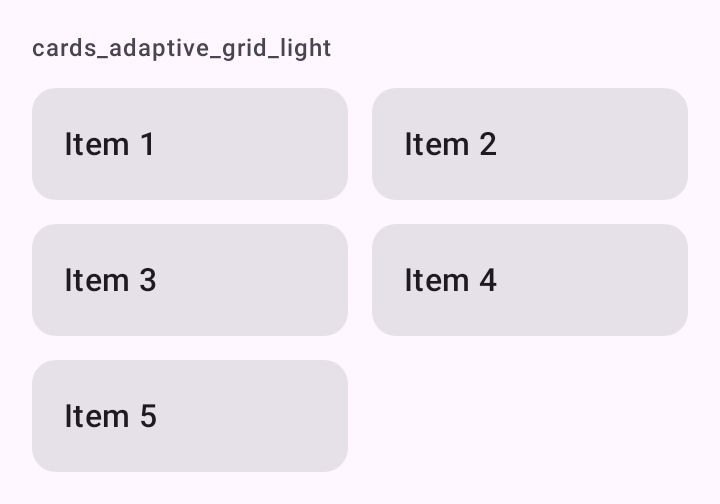

# DSAdaptiveGrid

Grade com número de colunas adaptativo, derivado da largura mínima do item, como o `GridCells.Adaptive`. Em tablet ou paisagem cabem mais colunas sem calcular breakpoints. É um `Layout` próprio do Compose, sem componente do Material por baixo.

## Quando usar

Para poucas dezenas de cards ou blocos lado a lado dentro de uma tela que rola. Ela não é preguiçosa: mede todos os filhos, então pode ficar dentro de uma coluna que rola (como a [`DSScreenColumn`](DSScreen.md)).

Para centenas de itens, use `LazyVerticalGrid(GridCells.Adaptive(...))`. Para duas colunas de conteúdo (principal e secundária), use [`DSAdaptiveColumns`](DSReadableColumn.md).

Cada item ocupa a largura da coluna e fica centralizado na altura da linha.

## Uso

```kotlin
DSAdaptiveGrid(minItemWidth = 140.dp) {
    properties.forEach { property ->
        DSCard(onClick = { open(property.id) }) {
            Text(property.title, style = DSTheme.typography.titleMedium)
        }
    }
}
```

## Parâmetros

| Parâmetro | Tipo | Padrão | Descrição |
| --- | --- | --- | --- |
| `modifier` | `Modifier` | `Modifier` | Modificador da grade. |
| `minItemWidth` | `Dp` | `160.dp` | Largura mínima de cada item. Define quantas colunas cabem (pelo menos uma). |
| `spacing` | `Dp` | `DSSpacing.md` | Espaço entre colunas e entre linhas. |
| `content` | `@Composable () -> Unit` | obrigatório | Os itens, em ordem de leitura. |

## Screenshots

`cards_adaptive_grid`:



Também existem `cards_adaptive_grid_dark`, `_font200`, `_rtl` e `_highcontrast`.
