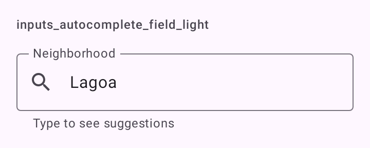
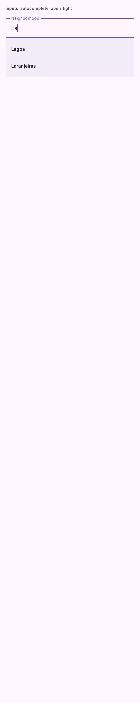

# DSAutocompleteField

Campo com sugestões enquanto digita, o "exposed dropdown menu" editável do Material 3 (`ExposedDropdownMenuBox` com `OutlinedTextField` e `ExposedDropdownMenu`). Serve para bairro, cidade, destinatário.

## Quando usar

Quando o usuário digita e escolhe entre muitas opções. O app filtra (localmente ou na rede) e passa as `suggestions` do `query` atual. Ao escolher uma, recebe `onSuggestionSelect` e normalmente põe o rótulo dela no `query`. O menu só abre quando há sugestões.

Para escolher entre poucas opções fixas, use [`DSDropdownField`](DSDropdownField.md). Para uma busca que ocupa a tela, use a `SearchBar` do Material.

## Uso

```kotlin
var query by remember { mutableStateOf("") }

DSAutocompleteField(
    query = query,
    onQueryChange = { query = it },
    suggestions = neighborhoods.filter { it.startsWith(query, ignoreCase = true) }.map { DSOption(it, it) },
    onSuggestionSelect = { query = it.label },
    label = "Bairro",
    leadingIcon = DSIcons.Search
)
```

## Parâmetros

| Parâmetro | Tipo | Padrão | Descrição |
| --- | --- | --- | --- |
| `query` | `String` | obrigatório | O texto digitado. |
| `onQueryChange` | `(String) -> Unit` | obrigatório | Chamado a cada edição; também abre o menu. |
| `suggestions` | `List<DSOption<T>>` | obrigatório | As sugestões do `query` atual. Lista vazia fecha o menu. |
| `onSuggestionSelect` | `(DSOption<T>) -> Unit` | obrigatório | Chamado com a sugestão tocada. |
| `label` | `String` | obrigatório | Rótulo do campo. |
| `modifier` | `Modifier` | `Modifier` | Modificador do campo. |
| `placeholder` | `String?` | `null` | Dica dentro do campo vazio. |
| `supportingText` | `String?` | `null` | Linha de apoio. Some quando há erro. |
| `errorText` | `String?` | `null` | Mensagem de erro. Não nula, o campo fica em estado de erro. |
| `leadingIcon` | `ImageVector?` | `null` | Ícone decorativo no início. |
| `enabled` | `Boolean` | `true` | Habilita ou desabilita o campo. |

O teclado usa `ImeAction.Done`.

## Acessibilidade

- O TalkBack lê o rótulo; o `ExposedDropdownMenuBox` do Material expõe o estado do menu.
- `leadingIcon` é decorativo.

## Screenshots

`inputs_autocomplete_field`:



Também existem `inputs_autocomplete_field_dark`, `_font200`, `_rtl` e `_highcontrast`.

`inputs_autocomplete_open` (menu aberto):



Só existe a versão clara.
