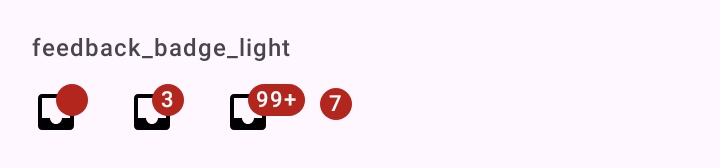

# DSBadge

Selo do Material 3: um ponto ou um número pequeno no canto de um ícone. `DSBadge` embrulha `Badge`; `DSBadgedBox` embrulha `BadgedBox` e põe o selo no canto do conteúdo.

## Quando usar

- `DSBadgedBox`: um ícone (ou outro conteúdo pequeno) com selo no canto, para mensagens não lidas ou novidade num ajuste. É o uso normal.
- `DSBadge`: o selo solto, quando o layout já é seu.

Nos itens de navegação, use o `badgeCount` do `DSNavigationItem` ([`DSNavigationBar`](DSNavigationBar.md)).

Regras do número: `count` 0 mostra só o ponto; acima de 99 mostra "99+". No `DSBadgedBox`, `count = null` esconde o selo.

## Uso

```kotlin
DSBadgedBox(count = unread, badgeDescription = "$unread mensagens não lidas") {
    Icon(DSIcons.Inbox, contentDescription = "Caixa de entrada")
}
```

```kotlin
DSBadge(count = 7)
```

## Parâmetros

`DSBadge`

| Parâmetro | Tipo | Padrão | Descrição |
| --- | --- | --- | --- |
| `modifier` | `Modifier` | `Modifier` | Modificador do selo. |
| `count` | `Int` | `0` | 0 mostra o ponto; acima de 99 mostra "99+". |

`DSBadgedBox`

| Parâmetro | Tipo | Padrão | Descrição |
| --- | --- | --- | --- |
| `count` | `Int?` | obrigatório | `null` esconde o selo; 0 mostra só o ponto. |
| `modifier` | `Modifier` | `Modifier` | Modificador da caixa. |
| `badgeDescription` | `String?` | `null` | O que o TalkBack lê no lugar do número ("3 mensagens não lidas"). Sem ele, lê só o número. |
| `content` | `@Composable BoxScope.() -> Unit` | obrigatório | O ícone ou conteúdo que recebe o selo. |

## Acessibilidade

- `badgeDescription` vira o `contentDescription` do selo.
- O ícone dentro do `DSBadgedBox` precisa do próprio `contentDescription`.

## Screenshots

`feedback_badge`:



Também existem `feedback_badge_dark`, `_font200`, `_rtl` e `_highcontrast`.
