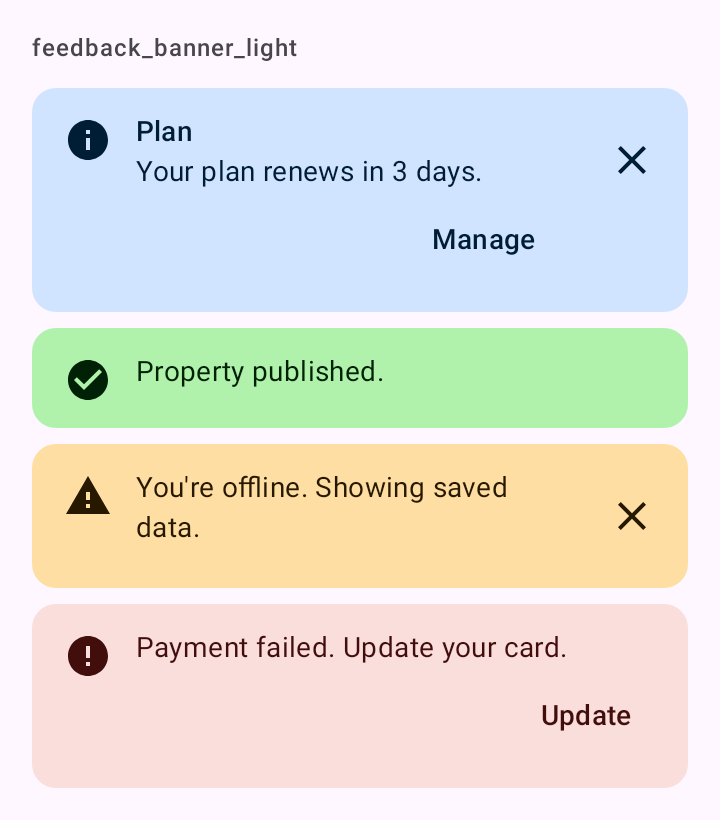

# DSBanner

Aviso que fica no conteúdo até ser resolvido ou dispensado: "Seu plano vence em 3 dias", "Sem conexão, mostrando dados salvos". O Material 3 não tem banner no Compose; este é uma `Surface` que segue o desenho do Material (contêiner tonal, texto e ação no tom do contêiner).

## Quando usar

Para um aviso que persiste na tela. Cada estilo usa o contêiner da cor, o ícone dela e, se houver, uma ação e um "x":

| Estilo | Cores | Ícone |
| --- | --- | --- |
| `Info` | `DSTheme.status.info.container` / `onContainer` | `DSIcons.Info` |
| `Success` | `DSTheme.status.success.container` / `onContainer` | `DSIcons.CheckCircle` |
| `Warning` | `DSTheme.status.warning.container` / `onContainer` | `DSIcons.Warning` |
| `Error` | `DSTheme.colors.errorContainer` / `onErrorContainer` | `DSIcons.Error` |

Para confirmar algo que acabou de acontecer, use o snackbar ([`showDSSnackbar`](DSSnackbar.md)). Para pedir uma decisão antes de seguir, use o [`DSAlertDialog`](DSAlertDialog.md).

## Uso

```kotlin
DSBanner(
    message = "Seu plano vence em 3 dias.",
    title = "Plano",
    actionText = "Gerenciar",
    onAction = { openPlan() },
    onDismiss = { hideBanner() }
)
```

```kotlin
DSBanner(message = "Sem conexão. Mostrando dados salvos.", style = DSBannerStyle.Warning)
```

## Parâmetros

| Parâmetro | Tipo | Padrão | Descrição |
| --- | --- | --- | --- |
| `message` | `String` | obrigatório | O texto do aviso. |
| `modifier` | `Modifier` | `Modifier` | Modificador do banner (que já ocupa a largura toda). |
| `style` | `DSBannerStyle` | `DSBannerStyle.Info` | `Info`, `Success`, `Warning` ou `Error`. |
| `title` | `String?` | `null` | Título opcional acima da mensagem. |
| `actionText` | `String?` | `null` | Rótulo da ação. Só aparece junto com `onAction`. |
| `onAction` | `(() -> Unit)?` | `null` | Chamado no toque da ação. |
| `onDismiss` | `(() -> Unit)?` | `null` | Mostra o "x" e é chamado no toque dele. |

## Acessibilidade

- O ícone do estilo é decorativo; o TalkBack lê título e mensagem.
- O "x" tem a descrição "Dispensar" (`dskit_dismiss`) e alvo de 48 dp (`IconButton` do Material 3).

## Screenshots

`feedback_banner`:



Também existem `feedback_banner_dark`, `_font200`, `_rtl` e `_highcontrast`.
