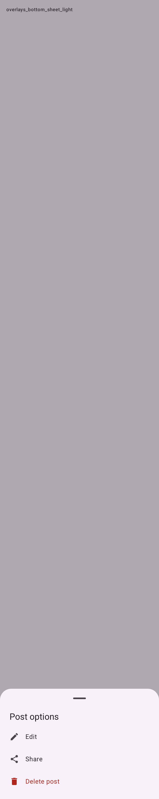
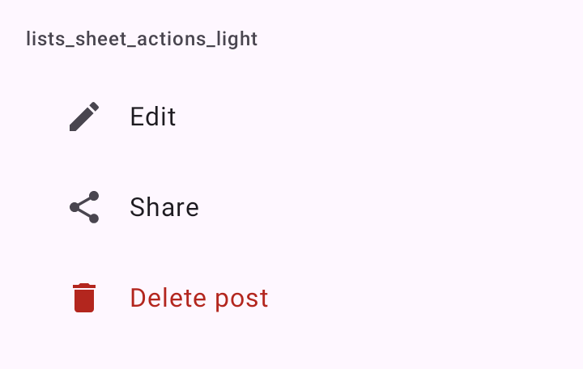

# DSBottomSheet

Painel modal que sobe da base da tela, o `ModalBottomSheet` do Material 3. Serve para escolhas rápidas, um formulário curto, as ações de um item. O arquivo também traz `DSSheetAction`, uma linha de ação (`ListItem` do Material 3) para esses painéis.

## Quando usar

- `DSBottomSheet`: para conteúdo temporário ligado à tela atual. Abre na altura do conteúdo: um painel curto não para no meio da tela. Conteúdo maior que a tela, como em fonte grande, rola. Trata a barra de navegação do sistema.
- `DSSheetAction`: cada ação de um painel de ações (editar, compartilhar, excluir). Ícone e rótulo, a linha inteira tocável. `destructive` pinta na cor de erro.

Para confirmar algo que não dá para desfazer, use o [`DSAlertDialog`](DSAlertDialog.md).

O painel é declarativo: `visible` abre e fecha, com a animação nos dois sentidos. Ao virar `false`, o painel desce antes de sair da tela.

## Uso

```kotlin
var showOptions by remember { mutableStateOf(false) }

DSBottomSheet(visible = showOptions, onDismissRequest = { showOptions = false }, title = "Opções") {
    DSSheetAction("Editar", onClick = { showOptions = false; edit() }, icon = DSIcons.Edit)

    DSSheetAction("Compartilhar", onClick = { showOptions = false; share() }, icon = DSIcons.Share)

    DSSheetAction("Excluir", onClick = { showOptions = false; delete() }, icon = DSIcons.Delete, destructive = true)
}
```

## Parâmetros

`DSBottomSheet`

| Parâmetro | Tipo | Padrão | Descrição |
| --- | --- | --- | --- |
| `visible` | `Boolean` | obrigatório | Se o painel está aberto. Ao virar `false`, o painel desce antes de sair da tela. |
| `onDismissRequest` | `() -> Unit` | obrigatório | O usuário arrastou para baixo, tocou fora ou usou o voltar: desligue `visible`. |
| `modifier` | `Modifier` | `Modifier` | Modificador do painel. |
| `title` | `String?` | `null` | Título opcional no topo do painel. |
| `content` | `@Composable ColumnScope.() -> Unit` | obrigatório | O conteúdo, numa coluna que rola. |

`DSSheetAction`

| Parâmetro | Tipo | Padrão | Descrição |
| --- | --- | --- | --- |
| `text` | `String` | obrigatório | O rótulo da ação. |
| `onClick` | `() -> Unit` | obrigatório | Chamado no toque. Não fecha o painel sozinho. |
| `modifier` | `Modifier` | `Modifier` | Modificador da linha. |
| `icon` | `ImageVector?` | `null` | Ícone decorativo à esquerda. |
| `destructive` | `Boolean` | `false` | Pinta rótulo e ícone na cor de erro. |
| `enabled` | `Boolean` | `true` | Desabilitada, a linha fica esmaecida e não recebe toque. |

## Acessibilidade

- O título do painel é marcado como `heading()`.
- Cada `DSSheetAction` é um `clickable` com `Role.Button`; o ícone é decorativo.
- O `ModalBottomSheet` do Material 3 fecha com o voltar do sistema e com a ação de dispensar do TalkBack.

## Screenshots

`overlays_bottom_sheet`:



Também existe `overlays_bottom_sheet_dark`.

`lists_sheet_actions` (as linhas `DSSheetAction` soltas):



Também existem `lists_sheet_actions_dark`, `_font200`, `_rtl` e `_highcontrast`.
