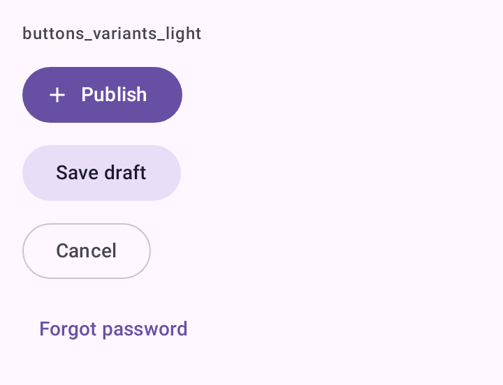
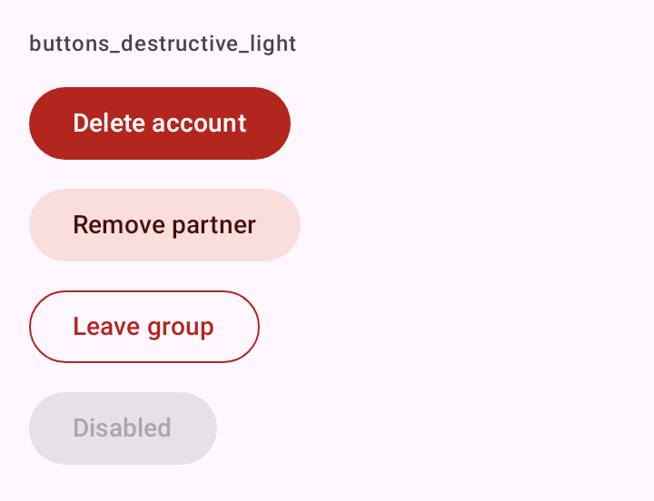
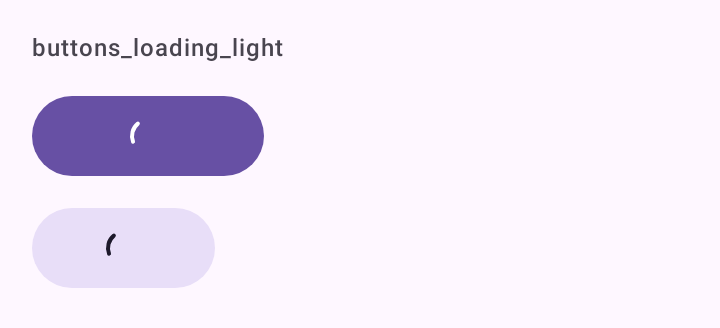

# DSButton

Os quatro botões de texto do DSKit: `DSButton`, `DSTonalButton`, `DSOutlinedButton` e `DSTextButton`. Embrulham `Button`, `FilledTonalButton`, `OutlinedButton` e `TextButton` do Material 3, com ícone opcional, estado de carregamento, variante destrutiva e vibração leve no toque.

## Quando usar

- `DSButton`: a ação principal da tela. No máximo uma por tela.
- `DSTonalButton`: uma ação importante que não é a principal ("Salvar rascunho" ao lado de "Publicar").
- `DSOutlinedButton`: ação secundária ao lado da principal ("Cancelar", "Ver detalhes").
- `DSTextButton`: a ação de menor peso (em diálogos, cards, "Esqueci a senha").

Para a ação que flutua sobre o conteúdo, use [`DSExtendedFab`](DSFab.md). Para um link dentro de uma frase, use [`DSTextLink`](DSTextLink.md).

## Uso

```kotlin
DSButton("Publicar", onClick = { publish() }, icon = DSIcons.Add, loading = isPublishing)

DSTonalButton("Salvar rascunho", onClick = { saveDraft() })

DSOutlinedButton("Cancelar", onClick = { dismiss() })
```

```kotlin
DSButton("Excluir conta", onClick = { deleteAccount() }, destructive = true)

DSTextButton("Esqueci a senha", onClick = { openRecovery() })
```

## Parâmetros

`DSButton`, `DSTonalButton` e `DSOutlinedButton` têm a mesma assinatura. `DSTextButton` não tem `loading`.

| Parâmetro | Tipo | Padrão | Descrição |
| --- | --- | --- | --- |
| `text` | `String` | obrigatório | Rótulo do botão. |
| `onClick` | `() -> Unit` | obrigatório | Chamado no toque. Ignorado enquanto `loading` for `true`. |
| `modifier` | `Modifier` | `Modifier` | Modificador do botão. |
| `icon` | `ImageVector?` | `null` | Ícone opcional antes do texto. Ajusta o padding interno. |
| `enabled` | `Boolean` | `true` | Habilita ou desabilita o botão. |
| `loading` | `Boolean` | `false` | Troca o conteúdo por um indicador circular, mantém a largura e ignora toques. Não existe em `DSTextButton`. |
| `destructive` | `Boolean` | `false` | Pinta na cor de erro. Cheio: `error`/`onError`. Tonal: `errorContainer`/`onErrorContainer`. Contorno e texto: conteúdo (e borda, no contorno habilitado) em `error`. |

## Acessibilidade

- O ícone é decorativo (`contentDescription = null`); o TalkBack lê só o texto.
- Com `loading = true`, o botão ganha `stateDescription` com a string "Carregando…" (`dskit_loading`), e o texto continua no layout (invisível) para ser lido.
- Alvo mínimo de 48 dp e `Role.Button` vêm dos botões do Material 3.
- A vibração do toque respeita `DSTheme.hapticsEnabled` e a configuração do sistema.

## Screenshots

`buttons_variants`:



Também existem `buttons_variants_dark`, `_font200`, `_rtl` e `_highcontrast`.

`buttons_destructive` (destrutivos e desabilitado):



Também existem `buttons_destructive_dark`, `_font200`, `_rtl` e `_highcontrast`.

`buttons_loading`:



Também existem `buttons_loading_dark` e `_font200`.
