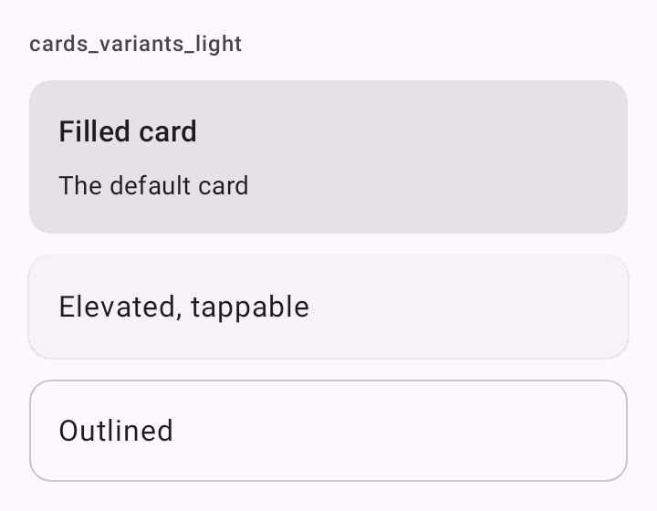

# DSCard

Card do Material 3: agrupa o conteúdo de um item (uma publicação, um resumo). Embrulha `Card`, `ElevatedCard` ou `OutlinedCard`, conforme a variante, e empilha o conteúdo numa `Column` com espaço `DSSpacing.sm` entre os filhos.

## Quando usar

| Variante | Uso |
| --- | --- |
| `Filled` | Fundo `surfaceContainerHighest`, sem sombra: o card padrão. |
| `Elevated` | Fundo `surfaceContainerLow` com sombra: quando o card precisa se destacar do que está atrás. |
| `Outlined` | Fundo da tela com contorno: listas de cards lado a lado, sem peso visual. |

Com `onClick`, o card inteiro é tocável. Para uma grade de cards que se adapta à largura, use [`DSAdaptiveGrid`](DSAdaptiveGrid.md).

## Uso

```kotlin
DSCard {
    Text("Apartamento em Ipanema", style = DSTheme.typography.titleMedium)

    Text("2 quartos, 80 m²", style = DSTheme.typography.bodyMedium)
}
```

```kotlin
DSCard(
    variant = DSCardVariant.Outlined,
    onClick = { openPost(post.id) },
    contentPadding = PaddingValues(0.dp)
) {
    Image(painter = painterResource(R.drawable.cover), contentDescription = null)
}
```

## Parâmetros

| Parâmetro | Tipo | Padrão | Descrição |
| --- | --- | --- | --- |
| `modifier` | `Modifier` | `Modifier` | Modificador do card. |
| `variant` | `DSCardVariant` | `DSCardVariant.Filled` | `Filled`, `Elevated` ou `Outlined`. |
| `onClick` | `(() -> Unit)?` | `null` | Torna o card inteiro tocável, com ripple e vibração leve. |
| `contentPadding` | `PaddingValues` | `PaddingValues(DSSpacing.lg)` | Folga interna. `PaddingValues(0.dp)` para uma imagem que vai até a borda. |
| `content` | `@Composable ColumnScope.() -> Unit` | obrigatório | Conteúdo, numa coluna com `DSSpacing.sm` entre os filhos. |

## Acessibilidade

- Com `onClick`, o TalkBack lê o conteúdo junto, como um botão.
- Para dar ao card um rótulo único (e uma dica de ação), use `Modifier.dsAccessibleCard(label, hint)`.

## Screenshots

`cards_variants`:



Também existem `cards_variants_dark`, `_font200`, `_rtl` e `_highcontrast`.
