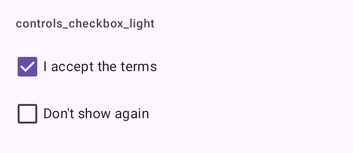

# DSCheckbox

Caixa de seleção ao lado de uma frase ("Não mostrar de novo", "Li e aceito os termos"), fora de uma lista. Embrulha `Checkbox` do Material 3 numa linha em que a frase também é tocável.

## Quando usar

Para uma opção solta numa tela ou formulário. Numa lista de opções, use [`DSCheckboxListItem`](DSListItem.md).

## Uso

```kotlin
var accepted by remember { mutableStateOf(false) }

DSCheckbox("Li e aceito os termos", checked = accepted, onCheckedChange = { accepted = it })
```

## Parâmetros

| Parâmetro | Tipo | Padrão | Descrição |
| --- | --- | --- | --- |
| `label` | `String` | obrigatório | A frase ao lado da caixa. |
| `checked` | `Boolean` | obrigatório | Estado marcado. |
| `onCheckedChange` | `(Boolean) -> Unit` | obrigatório | Chamado com o novo estado. |
| `modifier` | `Modifier` | `Modifier` | Modificador da linha. |
| `enabled` | `Boolean` | `true` | Desabilitado, a caixa e a frase ficam esmaecidas. |

## Acessibilidade

- A linha inteira é um único `toggleable` com `Role.Checkbox`: o TalkBack lê a frase e o estado juntos.
- Altura mínima de 48 dp (`DSTouchTarget.minimum`).

## Screenshots

`controls_checkbox`:



Também existem `controls_checkbox_dark`, `_font200`, `_rtl` e `_highcontrast`.
