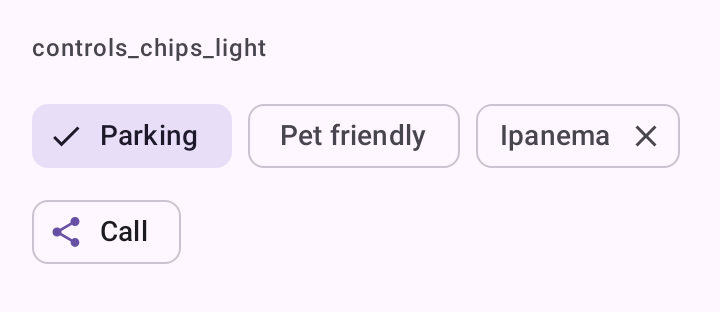

# DSChips

Os três chips do DSKit: `DSFilterChip`, `DSInputChip` e `DSAssistChip`. Embrulham `FilterChip`, `InputChip` e `AssistChip` do Material 3, com vibração leve no toque.

## Quando usar

- `DSFilterChip`: liga e desliga um filtro ("Com vaga", "Aceita pet"). Marcado, ganha o check à esquerda e o fundo tonal. Use vários num `FlowRow`.
- `DSInputChip`: um valor que o usuário adicionou e pode tirar (um bairro escolhido, um destinatário).
- `DSAssistChip`: um atalho ligado ao conteúdo ("Ligar", "Ver no mapa").

Para escolha única entre poucas opções sempre visíveis, use [`DSSegmentedButton`](DSSegmentedButton.md).

## Uso

```kotlin
FlowRow(horizontalArrangement = Arrangement.spacedBy(DSSpacing.sm)) {
    DSFilterChip("Com vaga", selected = parking, onSelectedChange = { parking = it })

    DSFilterChip("Aceita pet", selected = pets, onSelectedChange = { pets = it })
}
```

```kotlin
DSInputChip("Ipanema", onRemove = { remove("Ipanema") })

DSAssistChip("Ligar", onClick = { call() }, icon = DSIcons.Share)
```

## Parâmetros

`DSFilterChip`

| Parâmetro | Tipo | Padrão | Descrição |
| --- | --- | --- | --- |
| `label` | `String` | obrigatório | Rótulo do chip. |
| `selected` | `Boolean` | obrigatório | Estado marcado. |
| `onSelectedChange` | `(Boolean) -> Unit` | obrigatório | Chamado com o novo estado. |
| `modifier` | `Modifier` | `Modifier` | Modificador do chip. |
| `icon` | `ImageVector?` | `null` | Ícone à esquerda. Marcado, o check toma o lugar dele. |
| `enabled` | `Boolean` | `true` | Habilita ou desabilita o chip. |

`DSInputChip`

| Parâmetro | Tipo | Padrão | Descrição |
| --- | --- | --- | --- |
| `label` | `String` | obrigatório | O valor mostrado. |
| `onRemove` | `() -> Unit` | obrigatório | Chamado no toque do chip, para removê-lo. |
| `modifier` | `Modifier` | `Modifier` | Modificador do chip. |
| `icon` | `ImageVector?` | `null` | Ícone à esquerda. |
| `enabled` | `Boolean` | `true` | Habilita ou desabilita o chip. |

`DSAssistChip`

| Parâmetro | Tipo | Padrão | Descrição |
| --- | --- | --- | --- |
| `label` | `String` | obrigatório | Rótulo do chip. |
| `onClick` | `() -> Unit` | obrigatório | Chamado no toque. |
| `modifier` | `Modifier` | `Modifier` | Modificador do chip. |
| `icon` | `ImageVector?` | `null` | Ícone à esquerda. |
| `enabled` | `Boolean` | `true` | Habilita ou desabilita o chip. |

## Acessibilidade

- Os ícones à esquerda são decorativos; o TalkBack lê o rótulo.
- O "x" do `DSInputChip` tem a descrição "Remover <rótulo>" (`dskit_remove_item`).
- O toque em qualquer ponto do `DSInputChip` chama `onRemove`, não só no "x".

## Screenshots

`controls_chips`:



Também existem `controls_chips_dark`, `_font200`, `_rtl` e `_highcontrast`.
