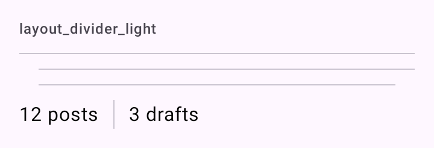

# DSDivider

Linha fina do Material 3 (`outlineVariant`) entre grupos de conteúdo. `DSDivider` embrulha `HorizontalDivider` com três recuos; `DSVerticalDivider` embrulha `VerticalDivider`.

## Quando usar

Use pouco: espaço e [`DSListSectionHeader`](DSListItem.md) separam melhor que linha.

| Recuo (`DSDividerInset`) | Uso |
| --- | --- |
| `None` | De ponta a ponta: separa seções. Padrão. |
| `Start` | Recuado no começo (`DSSpacing.lg`), alinhado ao texto de um `DSListItem` sem ícone: separa itens de uma mesma lista. |
| `Middle` | Recuado dos dois lados (`DSSpacing.lg`): separa conteúdo dentro de um cartão ou painel. |

`DSVerticalDivider` vai entre itens lado a lado (ações de um cartão, números de um resumo).

## Uso

```kotlin
DSListItem("Perfil")

DSDivider(inset = DSDividerInset.Start)

DSListItem("Plano")
```

```kotlin
Row(Modifier.height(IntrinsicSize.Min), horizontalArrangement = Arrangement.spacedBy(DSSpacing.md)) {
    Text("12 publicações")

    DSVerticalDivider()

    Text("3 rascunhos")
}
```

## Parâmetros

`DSDivider`

| Parâmetro | Tipo | Padrão | Descrição |
| --- | --- | --- | --- |
| `modifier` | `Modifier` | `Modifier` | Modificador da linha. |
| `inset` | `DSDividerInset` | `DSDividerInset.None` | `None`, `Start` ou `Middle`. |

`DSVerticalDivider`

| Parâmetro | Tipo | Padrão | Descrição |
| --- | --- | --- | --- |
| `modifier` | `Modifier` | `Modifier` | Modificador da linha. Numa `Row`, dê altura à linha (por exemplo `IntrinsicSize.Min`). |

## Screenshots

`layout_divider`:



Também existem `layout_divider_dark`, `_font200`, `_rtl` e `_highcontrast`.
