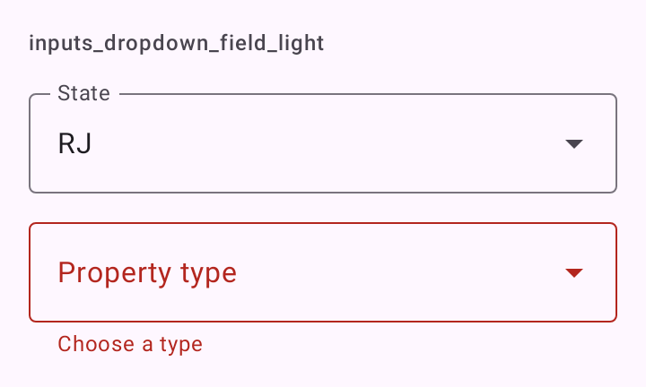

# DSDropdownField

Escolha única num menu que desce do campo, o "exposed dropdown menu" do Material 3 (`ExposedDropdownMenuBox` com `OutlinedTextField` só de leitura e `ExposedDropdownMenu`). Parece um [`DSTextField`](DSTextField.md) com a seta à direita. A opção escolhida ganha um check no menu.

## Quando usar

Para escolher uma opção numa lista fixa (estado, tipo de imóvel). Para poucas opções sempre visíveis, prefira [`DSSegmentedButton`](DSSegmentedButton.md). Para muitas, uma tela de busca. Para sugestões enquanto digita, use [`DSAutocompleteField`](DSAutocompleteField.md).

As opções são `DSOption<T>(value, label)`.

## Uso

```kotlin
var state by remember { mutableStateOf<String?>(null) }

DSDropdownField(
    selection = state,
    onSelectionChange = { state = it },
    options = listOf("RJ", "SP", "MG").map { DSOption(it, it) },
    label = "Estado"
)
```

## Parâmetros

| Parâmetro | Tipo | Padrão | Descrição |
| --- | --- | --- | --- |
| `selection` | `T?` | obrigatório | O valor escolhido, ou `null` enquanto nada foi escolhido. |
| `onSelectionChange` | `(T) -> Unit` | obrigatório | Chamado com o valor tocado no menu. |
| `options` | `List<DSOption<T>>` | obrigatório | As opções, na ordem. |
| `label` | `String` | obrigatório | Rótulo do campo. |
| `modifier` | `Modifier` | `Modifier` | Modificador do campo. |
| `supportingText` | `String?` | `null` | Linha de apoio. Some quando há erro. |
| `errorText` | `String?` | `null` | Mensagem de erro. Não nula, o campo fica em estado de erro. |
| `enabled` | `Boolean` | `true` | Desabilitado, o menu não abre. |

## Acessibilidade

- O TalkBack lê o rótulo e o valor escolhido; o `ExposedDropdownMenuBox` do Material expõe o estado de expandido.
- O check da opção escolhida é decorativo.

## Screenshots

`inputs_dropdown_field`:



Também existem `inputs_dropdown_field_dark`, `_font200`, `_rtl` e `_highcontrast`.
