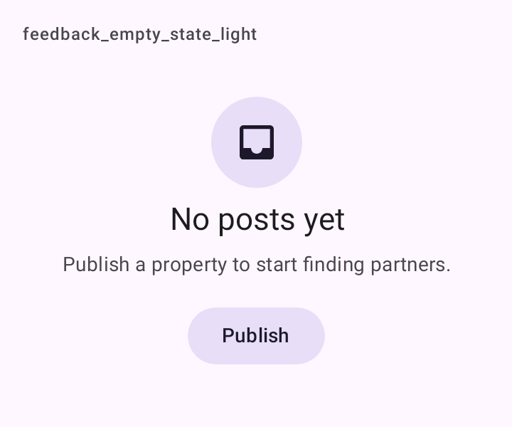

# DSEmptyState

Estado vazio: a lista não tem nada ainda. Ícone num círculo tonal (`secondaryContainer`), título, explicação e, se houver, a ação que resolve. Centralizado, com largura máxima de 360 dp. Montado com `Surface`, `Icon`, `Text` e um [`DSTonalButton`](DSButton.md).

## Quando usar

Quando a tela carregou e não há conteúdo ("Nenhuma publicação ainda"). Se a tela não carregou, use [`DSErrorState`](DSErrorState.md). Enquanto carrega, use [`DSLoadingState`](DSLoadingState.md) ou o [esqueleto](DSSkeleton.md).

## Uso

```kotlin
DSEmptyState(
    icon = DSIcons.Inbox,
    title = "Nenhuma publicação ainda",
    message = "Publique um imóvel para começar a encontrar parceiros.",
    actionText = "Publicar imóvel",
    onAction = { newPost() }
)
```

## Parâmetros

| Parâmetro | Tipo | Padrão | Descrição |
| --- | --- | --- | --- |
| `icon` | `ImageVector` | obrigatório | Ícone no círculo tonal. |
| `title` | `String` | obrigatório | Título. |
| `message` | `String` | obrigatório | Explicação. |
| `modifier` | `Modifier` | `Modifier` | Modificador do contêiner (que já ocupa a largura toda). |
| `actionText` | `String?` | `null` | Rótulo da ação. Só aparece junto com `onAction`. |
| `onAction` | `(() -> Unit)?` | `null` | Chamado no toque da ação. |

## Acessibilidade

- Ícone, título e mensagem são lidos juntos (`mergeDescendants`); o ícone é decorativo.
- O botão de ação continua tocável à parte.

## Screenshots

`feedback_empty_state`:



Também existem `feedback_empty_state_dark`, `_font200`, `_rtl` e `_highcontrast`.
