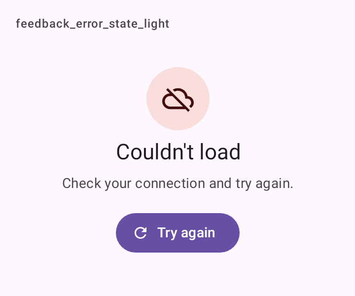

# DSErrorState

Estado de erro de uma tela que não carregou: ícone no contêiner de erro, título, explicação e o botão de tentar de novo. Tem o mesmo desenho do [`DSEmptyState`](DSEmptyState.md); o botão é um [`DSButton`](DSButton.md) com o ícone `DSIcons.Refresh`.

## Quando usar

Quando a tela inteira não carregou. Para um erro que não toma a tela, use um snackbar ([`showDSSnackbar`](DSSnackbar.md) com `DSSnackbarStyle.Error`) ou um [`DSBanner`](DSBanner.md).

## Uso

```kotlin
DSErrorState(
    title = "Não deu para carregar",
    message = "Confira sua conexão e tente de novo.",
    onRetry = { viewModel.reload() }
)
```

## Parâmetros

| Parâmetro | Tipo | Padrão | Descrição |
| --- | --- | --- | --- |
| `title` | `String` | obrigatório | Título. |
| `message` | `String` | obrigatório | Explicação. |
| `modifier` | `Modifier` | `Modifier` | Modificador do contêiner. |
| `icon` | `ImageVector` | `DSIcons.CloudOff` | Ícone no círculo `errorContainer`. |
| `retryText` | `String` | `stringResource(R.string.dskit_try_again)` | Rótulo do botão ("Tentar de novo"). |
| `onRetry` | `(() -> Unit)?` | `null` | Mostra o botão e é chamado no toque. Sem ele, não há botão. |

## Acessibilidade

- Ícone, título e mensagem são lidos juntos (`mergeDescendants`); o ícone é decorativo.
- O botão de tentar de novo continua tocável à parte.

## Screenshots

`feedback_error_state`:



Também existem `feedback_error_state_dark`, `_font200`, `_rtl` e `_highcontrast`.
