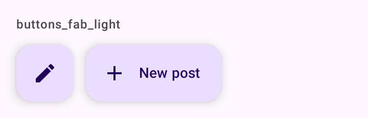

# DSFab

Botão de ação flutuante. `DSFab` embrulha `FloatingActionButton` e `DSExtendedFab` embrulha `ExtendedFloatingActionButton`, ambos do Material 3, com vibração leve no toque.

## Quando usar

- `DSFab`: a ação principal de uma tela de conteúdo (criar uma publicação, escrever uma mensagem).
- `DSExtendedFab`: quando o ícone sozinho não diz a ação ("Nova publicação"). Com `expanded = false` encolhe para só o ícone, o padrão ao rolar a lista para baixo.

Coloque o FAB no `floatingActionButton` do [`DSScreen`](DSScreen.md). Para a ação principal de um formulário, use [`DSButton`](DSButton.md).

## Uso

```kotlin
DSScreen(
    title = "Mensagens",
    floatingActionButton = { DSFab(DSIcons.Edit, "Nova mensagem", onClick = { compose() }) }
) { padding ->
    // conteúdo
}
```

```kotlin
val listState = rememberLazyListState()

DSExtendedFab(
    text = "Nova publicação",
    icon = DSIcons.Add,
    onClick = { newPost() },
    expanded = listState.firstVisibleItemIndex == 0
)
```

## Parâmetros

`DSFab`

| Parâmetro | Tipo | Padrão | Descrição |
| --- | --- | --- | --- |
| `icon` | `ImageVector` | obrigatório | Ícone do botão. |
| `contentDescription` | `String` | obrigatório | Rótulo lido pelo TalkBack. |
| `onClick` | `() -> Unit` | obrigatório | Chamado no toque. |
| `modifier` | `Modifier` | `Modifier` | Modificador do botão. |

`DSExtendedFab`

| Parâmetro | Tipo | Padrão | Descrição |
| --- | --- | --- | --- |
| `text` | `String` | obrigatório | Rótulo visível. |
| `icon` | `ImageVector` | obrigatório | Ícone antes do texto. |
| `onClick` | `() -> Unit` | obrigatório | Chamado no toque. |
| `modifier` | `Modifier` | `Modifier` | Modificador do botão. |
| `expanded` | `Boolean` | `true` | `false` encolhe para só o ícone. |

## Acessibilidade

- `DSFab` exige `contentDescription`, lido pelo TalkBack.
- No `DSExtendedFab` o ícone é decorativo; o TalkBack lê o `text`.

## Screenshots

`buttons_fab`:



Também existem `buttons_fab_dark`, `_font200`, `_rtl` e `_highcontrast`.
