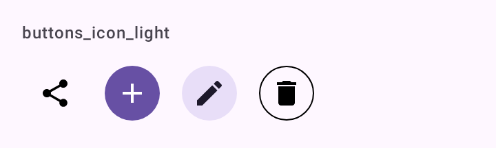

# DSIconButton

Botão só com ícone, num alvo de 48 dp. Embrulha `IconButton`, `FilledIconButton`, `FilledTonalIconButton` ou `OutlinedIconButton` do Material 3, conforme o estilo, dentro de um [`DSTooltip`](DSTooltip.md).

## Quando usar

Em ações de barra e de linha, quando o ícone basta. Escolha o estilo pelo peso da ação:

| Estilo | Uso |
| --- | --- |
| `Standard` | Só o ícone: ações de barra e de linha. Padrão. |
| `Filled` | Cheio na cor primária: a ação de destaque de um grupo. |
| `Tonal` | No contêiner secundário: ação importante sem competir com a principal. |
| `Outlined` | Com contorno: ação secundária ao lado de uma cheia. |

Se o ícone sozinho não diz a ação, use um [`DSButton`](DSButton.md) com `icon`.

## Uso

```kotlin
DSIconButton(DSIcons.Share, "Compartilhar", onClick = { share() })

DSIconButton(DSIcons.Delete, "Excluir", onClick = { delete() }, style = DSIconButtonStyle.Outlined)
```

## Parâmetros

| Parâmetro | Tipo | Padrão | Descrição |
| --- | --- | --- | --- |
| `icon` | `ImageVector` | obrigatório | Ícone do botão. |
| `contentDescription` | `String` | obrigatório | Lido pelo TalkBack e mostrado na dica ao segurar o botão. |
| `onClick` | `() -> Unit` | obrigatório | Chamado no toque. |
| `modifier` | `Modifier` | `Modifier` | Aplicado ao `DSTooltip` que envolve o botão. |
| `style` | `DSIconButtonStyle` | `DSIconButtonStyle.Standard` | `Standard`, `Filled`, `Tonal` ou `Outlined`. |
| `enabled` | `Boolean` | `true` | Habilita ou desabilita o botão. |

## Acessibilidade

- `contentDescription` é obrigatório: é o que o TalkBack lê.
- Segurar o botão mostra o mesmo texto numa dica (`DSTooltip`), como nos apps do Google.
- Alvo de 48 dp, garantido pelos botões de ícone do Material 3.

## Screenshots

`buttons_icon`:



Também existem `buttons_icon_dark`, `_font200`, `_rtl` e `_highcontrast`.
