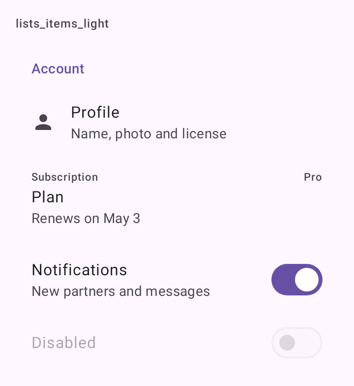
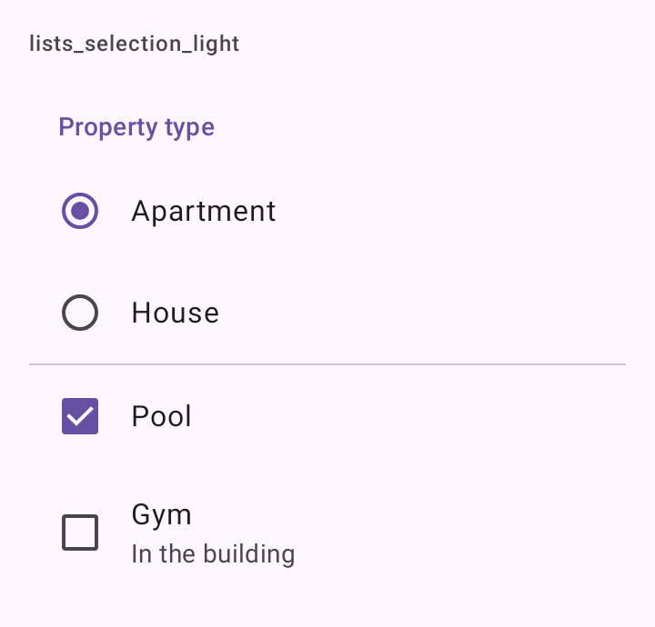

# DSListItem

Linha de lista do Material 3 (`ListItem`), a peça de toda lista e tela de ajustes. O arquivo traz cinco componentes:

- `DSListItem`: título, linha de apoio, sobretítulo, ícone ou conteúdo à esquerda e algo à direita.
- `DSSwitchListItem`: linha com `Switch` à direita.
- `DSCheckboxListItem`: linha com `Checkbox` à esquerda.
- `DSRadioListItem`: linha com `RadioButton` à esquerda.
- `DSListSectionHeader`: título de seção, na cor primária.

O fundo das linhas é transparente: a linha assume a cor de onde está (a tela, um card).

## Quando usar

- `DSListItem`: qualquer linha de lista. Com `onClick`, a linha inteira é tocável.
- `DSSwitchListItem`: um ajuste liga/desliga. A linha inteira alterna.
- `DSCheckboxListItem`: uma das várias opções que se marcam juntas. Fora de uma lista, use [`DSCheckbox`](DSCheckbox.md).
- `DSRadioListItem`: uma opção de escolha única. Empilhe numa coluna com `Modifier.selectableGroup()`.
- `DSListSectionHeader`: antes de um grupo de linhas, numa `Column` ou como `item` de uma `LazyColumn`, como nas telas de ajustes do Android.

Para as ações de um painel, use [`DSSheetAction`](DSBottomSheet.md). Para separar itens, prefira o `DSListSectionHeader` à [`DSDivider`](DSDivider.md).

## Uso

```kotlin
DSListSectionHeader("Conta")

DSListItem(
    "Perfil",
    supporting = "Nome, foto e CRECI",
    leadingIcon = DSIcons.Person,
    trailing = { Icon(DSIcons.ChevronRight, contentDescription = null) },
    onClick = { openProfile() }
)

DSSwitchListItem("Notificações", checked = notifications, onCheckedChange = { notifications = it })
```

```kotlin
Column(Modifier.selectableGroup()) {
    listOf("Apartamento", "Casa").forEach { option ->
        DSRadioListItem(option, selected = kind == option, onClick = { kind = option })
    }
}

DSCheckboxListItem("Piscina", checked = pool, onCheckedChange = { pool = it })
```

## Parâmetros

`DSListItem`

| Parâmetro | Tipo | Padrão | Descrição |
| --- | --- | --- | --- |
| `headline` | `String` | obrigatório | O título da linha. |
| `modifier` | `Modifier` | `Modifier` | Modificador da linha. |
| `supporting` | `String?` | `null` | Linha de apoio, abaixo do título. |
| `overline` | `String?` | `null` | Sobretítulo, acima do título. |
| `leadingIcon` | `ImageVector?` | `null` | Ícone decorativo à esquerda. |
| `leading` | `(@Composable () -> Unit)?` | `null` | Conteúdo à esquerda (avatar, imagem). Tem prioridade sobre `leadingIcon`. |
| `trailing` | `(@Composable () -> Unit)?` | `null` | Conteúdo à direita: um texto de valor, um ícone, um selo. |
| `enabled` | `Boolean` | `true` | Desabilitada, a linha fica esmaecida e não recebe toque. |
| `onClick` | `(() -> Unit)?` | `null` | Torna a linha inteira tocável. |

`DSSwitchListItem`

| Parâmetro | Tipo | Padrão | Descrição |
| --- | --- | --- | --- |
| `headline` | `String` | obrigatório | O título. |
| `checked` | `Boolean` | obrigatório | Estado do interruptor. |
| `onCheckedChange` | `(Boolean) -> Unit` | obrigatório | Chamado com o novo estado. |
| `modifier` | `Modifier` | `Modifier` | Modificador da linha. |
| `supporting` | `String?` | `null` | Linha de apoio. |
| `leadingIcon` | `ImageVector?` | `null` | Ícone decorativo à esquerda. |
| `enabled` | `Boolean` | `true` | Habilita ou desabilita a linha. |

`DSCheckboxListItem`

| Parâmetro | Tipo | Padrão | Descrição |
| --- | --- | --- | --- |
| `headline` | `String` | obrigatório | O título. |
| `checked` | `Boolean` | obrigatório | Estado marcado. |
| `onCheckedChange` | `(Boolean) -> Unit` | obrigatório | Chamado com o novo estado. |
| `modifier` | `Modifier` | `Modifier` | Modificador da linha. |
| `supporting` | `String?` | `null` | Linha de apoio. |
| `enabled` | `Boolean` | `true` | Habilita ou desabilita a linha. |

`DSRadioListItem`

| Parâmetro | Tipo | Padrão | Descrição |
| --- | --- | --- | --- |
| `headline` | `String` | obrigatório | O título. |
| `selected` | `Boolean` | obrigatório | Se esta opção é a escolhida. |
| `onClick` | `() -> Unit` | obrigatório | Chamado no toque da linha. |
| `modifier` | `Modifier` | `Modifier` | Modificador da linha. |
| `supporting` | `String?` | `null` | Linha de apoio. |
| `enabled` | `Boolean` | `true` | Habilita ou desabilita a linha. |

`DSListSectionHeader`

| Parâmetro | Tipo | Padrão | Descrição |
| --- | --- | --- | --- |
| `title` | `String` | obrigatório | O título da seção. |
| `modifier` | `Modifier` | `Modifier` | Modificador do texto. |

## Acessibilidade

- `DSListItem` com `onClick` é um `clickable` com `Role.Button`: o TalkBack lê a linha como um botão só.
- `DSSwitchListItem` é um `toggleable` com `Role.Switch`; o interruptor só desenha o estado.
- `DSCheckboxListItem` é um `toggleable` com `Role.Checkbox`.
- `DSRadioListItem` é um `selectable` com `Role.RadioButton`; dentro de um `selectableGroup()`, o TalkBack anuncia o grupo.
- `DSListSectionHeader` é marcado como `heading()`.
- Os ícones de `leadingIcon` são decorativos.
- A altura das linhas vem do `ListItem` do Material 3 (56 dp ou mais), acima do alvo de 48 dp.

## Screenshots

`lists_items`:



Também existem `lists_items_dark`, `_font200`, `_rtl` e `_highcontrast`.

`lists_selection`:



Também existem `lists_selection_dark`, `_font200`, `_rtl` e `_highcontrast`.
