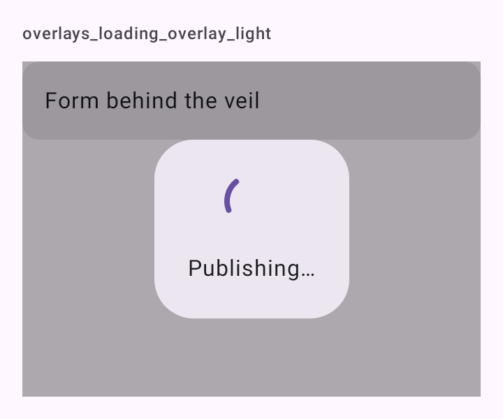

# DSLoadingOverlay

Carregamento que bloqueia a tela. O véu (`scrim`) do Material escurece tudo, um painel (`Surface`) no centro mostra o `CircularProgressIndicator` e a mensagem, e os toques param nele. Entra e sai com fade (`DSMotion.short()`).

## Quando usar

Durante uma ação que não pode começar duas vezes ("Publicando…", gerando um PDF). Ponha por cima da tela, num `Box` que ocupa tudo.

Para carregar o conteúdo de uma tela, prefira [`DSLoadingState`](DSLoadingState.md) ou o [esqueleto](DSSkeleton.md). Para o carregamento de um único botão, use `loading` do [`DSButton`](DSButton.md).

## Uso

```kotlin
Box(Modifier.fillMaxSize()) {
    PostForm()

    DSLoadingOverlay(visible = isPublishing, message = "Publicando…")
}
```

## Parâmetros

| Parâmetro | Tipo | Padrão | Descrição |
| --- | --- | --- | --- |
| `visible` | `Boolean` | obrigatório | Mostra ou esconde o véu, com fade. |
| `modifier` | `Modifier` | `Modifier` | Modificador do véu. |
| `message` | `String?` | `null` | Texto abaixo do indicador. |

## Acessibilidade

- O TalkBack anuncia a `message` (ou "Carregando…", `dskit_loading`) como região ao vivo (`LiveRegionMode.Polite`).
- O véu consome todos os toques: nada atrás dele recebe clique.

## Screenshots

`overlays_loading_overlay`:



Também existem `overlays_loading_overlay_dark` e `_font200`.
