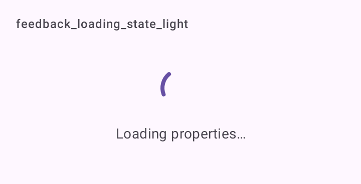

# DSLoadingState

Carregamento de uma tela inteira: o `CircularProgressIndicator` do Material 3 e uma legenda opcional, centralizados.

## Quando usar

Quando a forma do conteúdo não é conhecida. Quando ela é conhecida, prefira o esqueleto ([`Modifier.dsSkeleton`](DSSkeleton.md)), que não pula quando os dados chegam. Para bloquear a tela durante uma ação (enviar, publicar), use [`DSLoadingOverlay`](DSLoadingOverlay.md).

## Uso

```kotlin
DSLoadingState(message = "Carregando imóveis…")
```

## Parâmetros

| Parâmetro | Tipo | Padrão | Descrição |
| --- | --- | --- | --- |
| `modifier` | `Modifier` | `Modifier` | Modificador do contêiner (que já ocupa a largura toda). |
| `message` | `String?` | `null` | Legenda abaixo do indicador. |

## Acessibilidade

- Indicador e legenda são lidos juntos (`mergeDescendants`).

## Screenshots

`feedback_loading_state`:



Também existem `feedback_loading_state_dark` e `_font200`.
