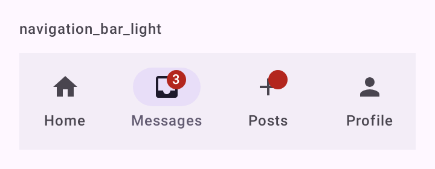
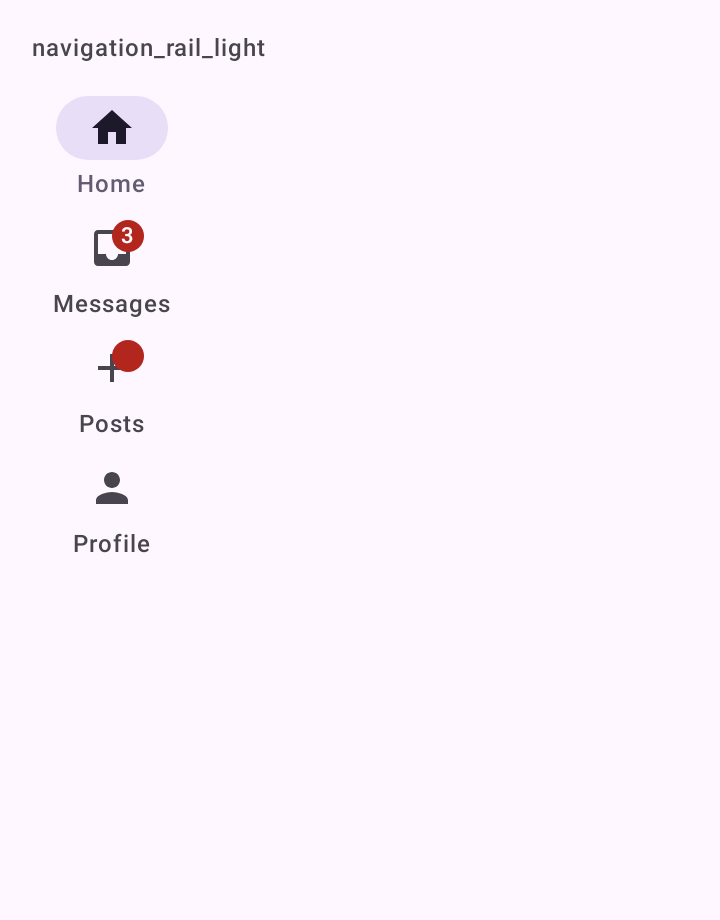

# DSNavigationBar

A navegação principal do app. O arquivo traz:

- `DSNavigationScaffold`: o `NavigationSuiteScaffold` do Material 3. Barra embaixo no celular, barra lateral em tablet e dobrável aberto, escolhida pelo tamanho da janela.
- `DSNavigationBar`: a `NavigationBar` do Material 3, solta.
- `DSNavigationRail`: a `NavigationRail` do Material 3, solta.
- `DSNavigationItem`: um destino (uma aba), usado pelos três.

## Quando usar

Use o `DSNavigationScaffold` na raiz do app, com de três a cinco destinos principais. O conteúdo é a tela da aba (um [`DSScreen`](DSScreen.md)), que já recebe os insets descontados da barra.

Use `DSNavigationBar` ou `DSNavigationRail` direto só num layout próprio.

Para seções irmãs dentro de uma mesma tela, use [`DSTabs`](DSTabs.md).

## Uso

```kotlin
enum class Tab { Home, Messages, Profile }

val tabs = listOf(
    DSNavigationItem(Tab.Home, "Início", DSIcons.Home),
    DSNavigationItem(Tab.Messages, "Mensagens", DSIcons.Inbox, badgeCount = unread),
    DSNavigationItem(Tab.Profile, "Perfil", DSIcons.Person)
)

DSNavigationScaffold(items = tabs, selection = tab, onSelectionChange = { tab = it }) {
    when (tab) {
        Tab.Home -> HomeScreen()

        Tab.Messages -> MessagesScreen()

        Tab.Profile -> ProfileScreen()
    }
}
```

## Parâmetros

`DSNavigationItem<T>`

| Parâmetro | Tipo | Padrão | Descrição |
| --- | --- | --- | --- |
| `key` | `T` | obrigatório | O valor que identifica a aba (um enum, uma rota). |
| `label` | `String` | obrigatório | Rótulo curto, sempre visível; é o que o TalkBack lê. |
| `icon` | `ImageVector` | obrigatório | Ícone da aba. |
| `selectedIcon` | `ImageVector?` | `null` | Versão preenchida, usada quando a aba está ativa. |
| `badgeCount` | `Int?` | `null` | Número no selo (conversas não lidas); `0` mostra só o ponto, `null` não mostra nada. |

`DSNavigationScaffold<T>`

| Parâmetro | Tipo | Padrão | Descrição |
| --- | --- | --- | --- |
| `items` | `List<DSNavigationItem<T>>` | obrigatório | Os destinos. |
| `selection` | `T` | obrigatório | A `key` da aba ativa. |
| `onSelectionChange` | `(T) -> Unit` | obrigatório | Chamado com a `key` tocada. |
| `modifier` | `Modifier` | `Modifier` | Modificador do scaffold. |
| `showsNavigation` | `Boolean` | `true` | `false` esconde a navegação (uma tela de tela cheia dentro da aba). |
| `content` | `@Composable () -> Unit` | obrigatório | A tela da aba ativa. |

`DSNavigationBar<T>`

| Parâmetro | Tipo | Padrão | Descrição |
| --- | --- | --- | --- |
| `items` | `List<DSNavigationItem<T>>` | obrigatório | Os destinos. |
| `selection` | `T` | obrigatório | A `key` da aba ativa. |
| `onSelectionChange` | `(T) -> Unit` | obrigatório | Chamado com a `key` tocada. |
| `modifier` | `Modifier` | `Modifier` | Modificador da barra. |

`DSNavigationRail<T>`

| Parâmetro | Tipo | Padrão | Descrição |
| --- | --- | --- | --- |
| `items` | `List<DSNavigationItem<T>>` | obrigatório | Os destinos. |
| `selection` | `T` | obrigatório | A `key` da aba ativa. |
| `onSelectionChange` | `(T) -> Unit` | obrigatório | Chamado com a `key` tocada. |
| `modifier` | `Modifier` | `Modifier` | Modificador da barra lateral. |
| `header` | `(@Composable () -> Unit)?` | `null` | Conteúdo no topo da barra lateral (um FAB, um logo). |

## Acessibilidade

- O ícone de cada aba é decorativo; o TalkBack lê o `label`, sempre visível.
- Os itens do Material 3 expõem `Role.Tab` e o estado selecionado.
- O selo usa o [`DSBadgedBox`](DSBadge.md).
- Tocar a aba já ativa não vibra.

## Screenshots

`navigation_bar`:



Também existem `navigation_bar_dark`, `_font200`, `_rtl` e `_highcontrast`.

`navigation_rail`:



Também existem `navigation_rail_dark`, `_font200`, `_rtl` e `_highcontrast`.
