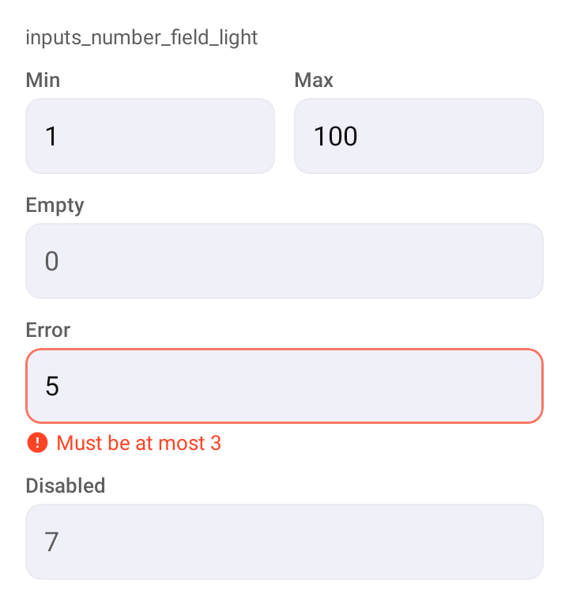
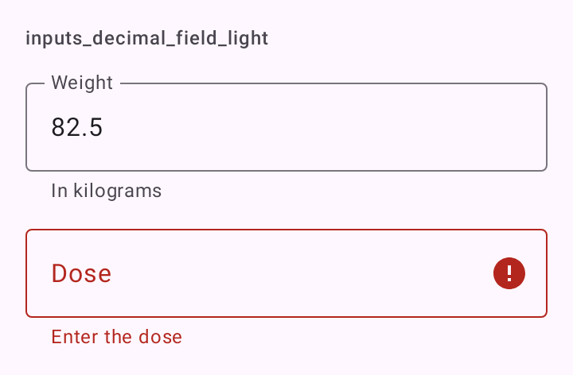

# DSNumberField

O arquivo traz dois campos numéricos: `DSNumberField`, para um inteiro, e `DSDecimalField`, para um número com casas decimais.

`DSNumberField` é o campo para um número inteiro, sobre o [`DSTextField`](DSTextField.md) (e, por baixo, o `OutlinedTextField` do Material 3). Abre o teclado numérico e entrega o valor já convertido.

## Quando usar

Para um inteiro digitado (quartos, área mínima, ano). Texto que não é número vira `null` e mostra `invalidNumberMessage`; campo vazio também é `null`, sem erro. Para escolher um valor num intervalo arrastando, use [`DSSlider`](DSSlider.md); para o ajuste fino em passos, o [`DSStepper`](DSStepper.md).

`DSDecimalField`: para um número com casas decimais digitado (peso, dose, quantidade). Entrega `Double?` com as mesmas regras de vazio e inválido. Para dinheiro, guarde centavos inteiros e use um [`DSTextField`](DSTextField.md) com `visualTransformation`: `Double` não serve para valores monetários.

## Uso

```kotlin
var minimum by remember { mutableStateOf<Int?>(null) }
var maximum by remember { mutableStateOf<Int?>(null) }

Row(horizontalArrangement = Arrangement.spacedBy(DSSpacing.md)) {
    DSNumberField(value = minimum, onValueChange = { minimum = it }, label = "Mín.", modifier = Modifier.weight(1f))

    DSNumberField(value = maximum, onValueChange = { maximum = it }, label = "Máx.", modifier = Modifier.weight(1f))
}
```

```kotlin
var weight by remember { mutableStateOf<Double?>(null) }

DSDecimalField(value = weight, onValueChange = { weight = it }, label = "Peso", supportingText = "Em quilos", maxFractionDigits = 1)
```

## Parâmetros

`DSNumberField`

| Parâmetro | Tipo | Padrão | Descrição |
| --- | --- | --- | --- |
| `value` | `Int?` | obrigatório | O número atual, ou `null` se vazio ou inválido. Mudou por fora (reset), o texto acompanha. |
| `onValueChange` | `(Int?) -> Unit` | obrigatório | Chamado a cada edição com o número convertido. |
| `label` | `String` | obrigatório | Rótulo do campo. |
| `modifier` | `Modifier` | `Modifier` | Modificador do campo. |
| `supportingText` | `String?` | `null` | Linha de apoio. |
| `errorText` | `String?` | `null` | Erro vindo do app (fora do intervalo, por exemplo). Tem prioridade sobre `invalidNumberMessage`. |
| `invalidNumberMessage` | `String` | `stringResource(R.string.dskit_enter_valid_number)` | Erro mostrado quando o texto não é número ("Digite um número válido"). |
| `enabled` | `Boolean` | `true` | Habilita ou desabilita o campo. |

| `imeAction` | `ImeAction` | `ImeAction.Done` | A ação do teclado. |
| `keyboardActions` | `KeyboardActions` | `KeyboardActions.Default` | O que a ação do teclado faz. |

O teclado é `KeyboardType.Number`.

`DSDecimalField` tem os mesmos parâmetros, com `value: Double?` e `onValueChange: (Double?) -> Unit`, e mais:

| Parâmetro | Tipo | Padrão | Descrição |
| --- | --- | --- | --- |
| `placeholder` | `String?` | `null` | Dica dentro do campo vazio. |
| `maxFractionDigits` | `Int` | `2` | Casas decimais aceitas na digitação e mostradas (2 em mg, 1 em kg). |

O teclado é `KeyboardType.Decimal`.

## Comportamento do DSDecimalField

- Vírgula e ponto valem como separador decimal em qualquer idioma. Alguns teclados só oferecem o ponto, e ele não pode ser descartado: "0.5" virar 50 é erro grave numa dose.
- O valor que chega de fora aparece com o separador do idioma do aparelho, em algarismos de 0 a 9 e sem separador de milhar ("1.234" se leria como 1,234 ao editar).
- Dígitos além de `maxFractionDigits` não entram. Dois separadores ("1.2.3") ou letras mostram `invalidNumberMessage`.
- O campo não aplica faixa: valide no app e mostre o problema em `errorText`.

## Acessibilidade

- Herda do `DSTextField`: o TalkBack lê o `label` e anuncia o erro (inclusive o de número inválido).

## Screenshots

`inputs_number_field`:



Também existem `inputs_number_field_dark`, `_font200`, `_rtl` e `_highcontrast`.

`inputs_decimal_field`:



Também existem `inputs_decimal_field_dark`, `_font200`, `_rtl` e `_highcontrast`.
