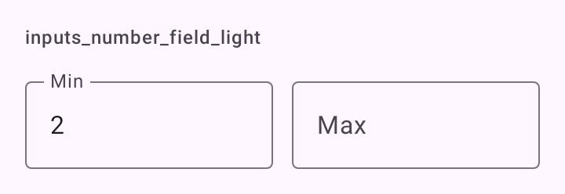

# DSNumberField

Campo para um número inteiro, sobre o [`DSTextField`](DSTextField.md) (e, por baixo, o `OutlinedTextField` do Material 3). Abre o teclado numérico e entrega o valor já convertido.

## Quando usar

Para um inteiro digitado (quartos, área mínima, ano). Texto que não é número vira `null` e mostra `invalidNumberMessage`; campo vazio também é `null`, sem erro. Para escolher um valor num intervalo arrastando, use [`DSSlider`](DSSlider.md).

## Uso

```kotlin
var minimum by remember { mutableStateOf<Int?>(null) }
var maximum by remember { mutableStateOf<Int?>(null) }

Row(horizontalArrangement = Arrangement.spacedBy(DSSpacing.md)) {
    DSNumberField(value = minimum, onValueChange = { minimum = it }, label = "Mín.", modifier = Modifier.weight(1f))

    DSNumberField(value = maximum, onValueChange = { maximum = it }, label = "Máx.", modifier = Modifier.weight(1f))
}
```

## Parâmetros

| Parâmetro | Tipo | Padrão | Descrição |
| --- | --- | --- | --- |
| `value` | `Int?` | obrigatório | O número atual, ou `null` se vazio ou inválido. Mudou por fora (reset), o texto acompanha. |
| `onValueChange` | `(Int?) -> Unit` | obrigatório | Chamado a cada edição com o número convertido. |
| `label` | `String` | obrigatório | Rótulo do campo. |
| `modifier` | `Modifier` | `Modifier` | Modificador do campo. |
| `supportingText` | `String?` | `null` | Linha de apoio. |
| `errorText` | `String?` | `null` | Erro vindo do app (fora do intervalo, por exemplo). Tem prioridade sobre `invalidNumberMessage`. |
| `invalidNumberMessage` | `String` | `stringResource(R.string.dskit_enter_valid_number)` | Erro mostrado quando o texto não é número ("Digite um número válido"). |
| `enabled` | `Boolean` | `true` | Habilita ou desabilita o campo. |

O teclado é `KeyboardType.Number` com `ImeAction.Done`.

## Acessibilidade

- Herda do `DSTextField`: o TalkBack lê o `label` e anuncia o erro (inclusive o de número inválido).

## Screenshots

`inputs_number_field`:



Também existem `inputs_number_field_dark`, `_font200`, `_rtl` e `_highcontrast`.
