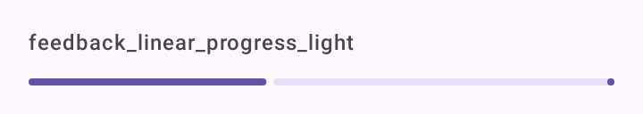

# DSProgress

`DSLinearProgress`: a barra de progresso linear do Material 3 (`LinearProgressIndicator`), na largura toda.

## Quando usar

- Com `progress`: mostra quanto já foi (envio de fotos, passo de um cadastro).
- Sem `progress`: indeterminada, para um carregamento curto no topo de uma lista.

Para o carregamento de uma tela inteira, use [`DSLoadingState`](DSLoadingState.md).

## Uso

```kotlin
DSLinearProgress(progress = uploaded / total.toFloat())
```

```kotlin
if (refreshing) {
    DSLinearProgress()
}
```

## Parâmetros

| Parâmetro | Tipo | Padrão | Descrição |
| --- | --- | --- | --- |
| `modifier` | `Modifier` | `Modifier` | Modificador da barra (que já ocupa a largura toda). |
| `progress` | `Float?` | `null` | De 0 a 1 (valores fora são limitados a esse intervalo), ou `null` para indeterminada. |

## Screenshots

`feedback_linear_progress`:



Também existem `feedback_linear_progress_dark`, `_font200`, `_rtl` e `_highcontrast`.
