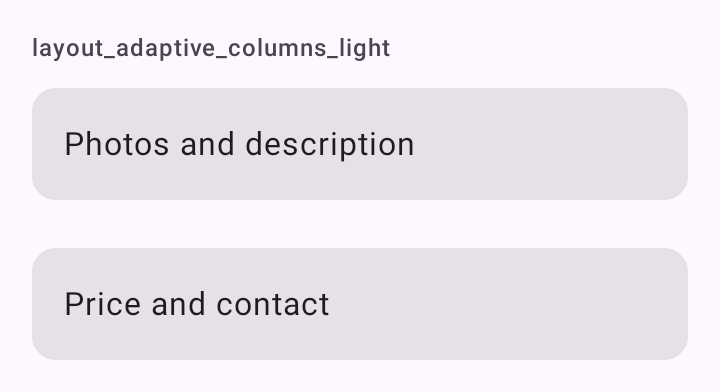

# DSReadableColumn

Layout para tela larga (tablet, dobrável aberto, paisagem). O arquivo traz três peças, todas em Compose puro, sem componente do Material por baixo:

- `Modifier.dsReadableColumn`: centra o conteúdo numa coluna de largura máxima quando sobra largura. No celular não faz nada.
- `DSAdaptiveColumns`: duas colunas, lado a lado em tela larga e empilhadas abaixo do breakpoint.
- `DSLayout`: as medidas usadas pelas duas.

## Quando usar

- `dsReadableColumn`: para texto e formulários não esticarem em tela larga. A [`DSScreenColumn`](DSScreen.md) já aplica a coluna; numa `LazyColumn`, aplique no item ou no conteúdo.
- `DSAdaptiveColumns`: para o detalhe de tablet (o conteúdo à esquerda, o resumo e as ações à direita). Abaixo do breakpoint, uma embaixo da outra, na mesma ordem. Coluna vazia não ocupa espaço.

Dentro de uma `DSScreenColumn` as duas colunas nunca cabem, porque ela limita a largura a `DSLayout.readableWidth`. Use `DSAdaptiveColumns` numa coluna própria, com `Modifier.verticalScroll`.

Para uma grade de muitos itens, use [`DSAdaptiveGrid`](DSAdaptiveGrid.md).

| Medida | Valor | Uso |
| --- | --- | --- |
| `DSLayout.readableWidth` | `600.dp` | Largura máxima da coluna de leitura: um celular grande, com espaço para dois cards lado a lado. |
| `DSLayout.twoColumnBreakpoint` | `680.dp` | A partir desta largura, o `DSAdaptiveColumns` põe as duas colunas lado a lado. |

## Uso

```kotlin
LazyColumn(contentPadding = DSScreenDefaults.contentPadding(padding)) {
    items(posts) { post ->
        PostCard(post, Modifier.dsReadableColumn())
    }
}
```

```kotlin
Column(Modifier.verticalScroll(rememberScrollState()).padding(DSScreenDefaults.contentPadding(padding))) {
    DSAdaptiveColumns(
        primary = { DSCard { Text("Fotos e descrição") } },
        secondary = { DSCard { Text("Preço e contato") } }
    )
}
```

## Parâmetros

`Modifier.dsReadableColumn`

| Parâmetro | Tipo | Padrão | Descrição |
| --- | --- | --- | --- |
| `maxWidth` | `Dp` | `DSLayout.readableWidth` | Largura máxima da coluna. A largura vem das restrições do pai, nunca do conteúdo. |

`DSAdaptiveColumns`

| Parâmetro | Tipo | Padrão | Descrição |
| --- | --- | --- | --- |
| `modifier` | `Modifier` | `Modifier` | Modificador do layout (que já ocupa a largura toda). |
| `breakpoint` | `Dp` | `DSLayout.twoColumnBreakpoint` | Largura a partir da qual as colunas ficam lado a lado. |
| `spacing` | `Dp` | `DSSpacing.xl` | Espaço entre as colunas e entre os filhos de cada coluna. |
| `primary` | `@Composable ColumnScope.() -> Unit` | obrigatório | A coluna principal (à esquerda, ou em cima). |
| `secondary` | `@Composable ColumnScope.() -> Unit` | obrigatório | A coluna secundária (à direita, ou embaixo). |

## Screenshots

`layout_adaptive_columns`:



Também existem `layout_adaptive_columns_dark`, `_font200`, `_rtl` e `_highcontrast`.
