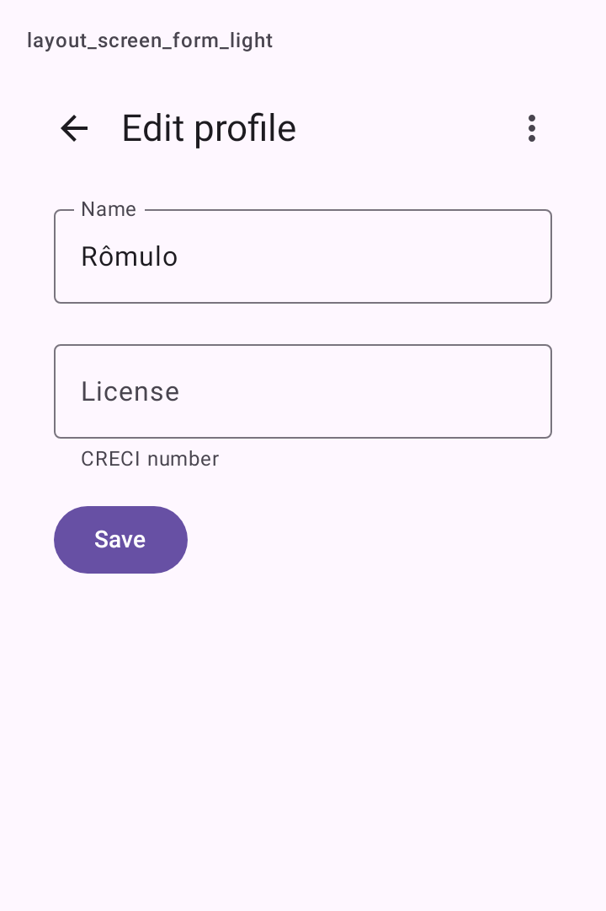
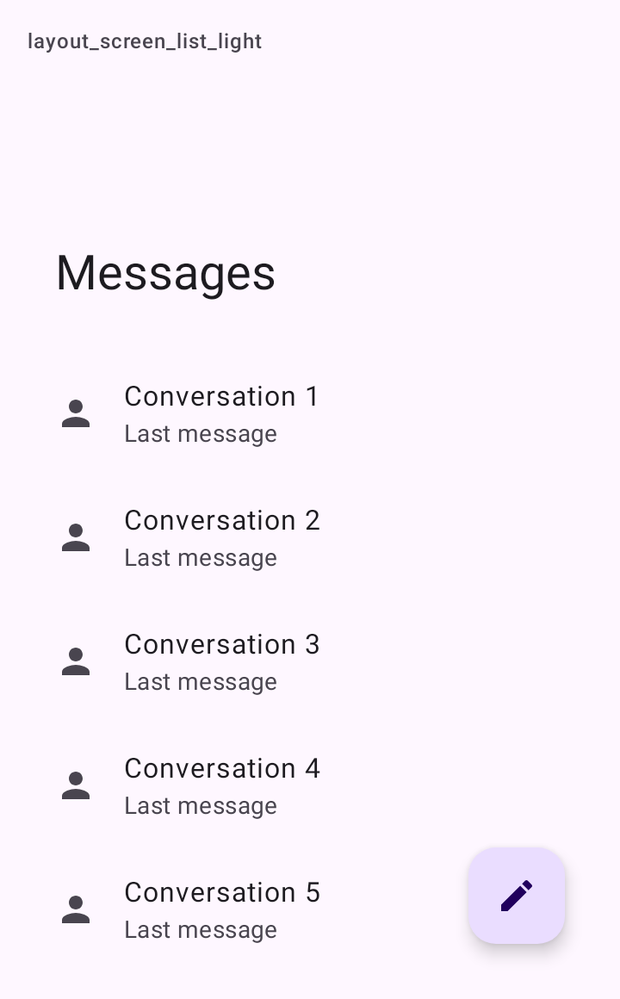

# DSScreen

Uma tela do app: o `Scaffold` do Material 3 com o que toda tela repete. Barra superior (que encolhe ou muda de cor ao rolar), FAB, barra inferior, snackbar e "puxar para atualizar" (`PullToRefreshBox`). O arquivo também traz `DSScreenColumn` e `DSScreenDefaults`.

## Quando usar

Em toda tela. O conteúdo recebe o `PaddingValues` das barras, como no `Scaffold`, e decide como rolar:

- `DSScreenColumn` para formulários e telas curtas: coluna que rola como um todo, com as margens de tela, espaço entre os blocos, coluna de leitura em tela larga e folga para o teclado, para o campo focado nunca ficar escondido.
- `LazyColumn` com `DSScreenDefaults.contentPadding(padding)` para listas: o primeiro e o último item não encostam nas barras, e a lista rola por baixo delas.

Sem `title` e sem `onBack`, a tela não tem barra superior. Com `topBarStyle` `Medium` ou `Large`, a barra encolhe ao rolar; com `Small` ou `CenterAligned`, muda de cor.

Para a navegação principal do app (abas), envolva as telas num [`DSNavigationScaffold`](DSNavigationBar.md).

## Uso

```kotlin
DSScreen(title = "Editar perfil", onBack = { navController.popBackStack() }) { padding ->
    DSScreenColumn(padding) {
        DSTextField(value = name, onValueChange = { name = it }, label = "Nome")

        DSButton("Salvar", onClick = { save() })
    }
}
```

```kotlin
DSScreen(
    title = "Publicações",
    topBarStyle = DSTopAppBarStyle.Large,
    floatingActionButton = { DSFab(DSIcons.Edit, "Nova publicação", onClick = { newPost() }) },
    snackbarHostState = snackbarHostState,
    isRefreshing = refreshing,
    onRefresh = { viewModel.refresh() }
) { padding ->
    LazyColumn(contentPadding = DSScreenDefaults.contentPadding(padding, horizontalMargin = 0.dp)) {
        items(posts) { post -> DSListItem(post.title, supporting = post.summary) }
    }
}
```

## Parâmetros

`DSScreen`

| Parâmetro | Tipo | Padrão | Descrição |
| --- | --- | --- | --- |
| `modifier` | `Modifier` | `Modifier` | Modificador do `Scaffold`. |
| `title` | `String?` | `null` | Título da barra superior. Sem título e sem `onBack`, não há barra. |
| `topBarStyle` | `DSTopAppBarStyle` | `DSTopAppBarStyle.Small` | O tamanho da barra; `Medium` e `Large` encolhem ao rolar. |
| `onBack` | `(() -> Unit)?` | `null` | Mostra a seta de voltar. |
| `actions` | `@Composable RowScope.() -> Unit` | `{}` | Botões à direita da barra. |
| `floatingActionButton` | `@Composable () -> Unit` | `{}` | O FAB, acima da barra inferior. |
| `bottomBar` | `@Composable () -> Unit` | `{}` | Barra inferior. |
| `snackbarHostState` | `SnackbarHostState?` | `null` | Onde os snackbars da tela aparecem (acima do FAB e da barra inferior), com um `DSSnackbarHost`. |
| `isRefreshing` | `Boolean` | `false` | Mostra o indicador do "puxar para atualizar". |
| `onRefresh` | `(() -> Unit)?` | `null` | Liga o "puxar para atualizar". |
| `content` | `@Composable (PaddingValues) -> Unit` | obrigatório | O conteúdo, que recebe o padding das barras. |

`DSScreenColumn`

| Parâmetro | Tipo | Padrão | Descrição |
| --- | --- | --- | --- |
| `innerPadding` | `PaddingValues` | obrigatório | O padding recebido do `DSScreen`. |
| `modifier` | `Modifier` | `Modifier` | Modificador da coluna. |
| `verticalArrangement` | `Arrangement.Vertical` | `Arrangement.spacedBy(DSSpacing.lg)` | Espaço entre os blocos. |
| `content` | `@Composable ColumnScope.() -> Unit` | obrigatório | O conteúdo. |

`DSScreenDefaults`

| Membro | Tipo | Descrição |
| --- | --- | --- |
| `margin` | `Dp` | Margem lateral do conteúdo, a do Material em janela compacta (`DSSpacing.lg`). |
| `contentPadding(innerPadding, horizontalMargin = margin)` | `PaddingValues` | O padding das barras somado às margens de tela (`DSSpacing.sm` em cima, `DSSpacing.xl` embaixo), para o `contentPadding` de uma `LazyColumn`. Passe `horizontalMargin = 0.dp` numa lista de `DSListItem`, que já tem a sua margem. |

## Acessibilidade

- O título da barra é marcado como `heading()`, para o TalkBack navegar por títulos.
- A seta de voltar tem a descrição "Voltar" (`dskit_back`).
- A `DSScreenColumn` aplica `imePadding()`: o campo focado não fica atrás do teclado.

## Screenshots

`layout_screen_form`:



Também existem `layout_screen_form_dark`, `_font200`, `_rtl` e `_highcontrast`.

`layout_screen_list`:



Também existem `layout_screen_list_dark`, `_font200`, `_rtl` e `_highcontrast`.
