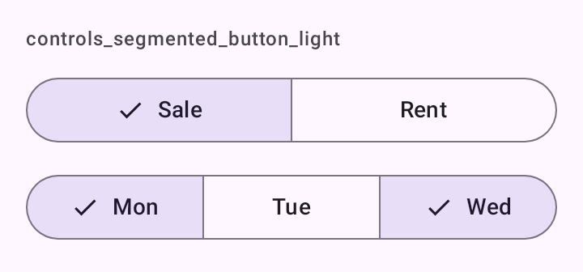

# DSSegmentedButton

Botões segmentados do Material 3. `DSSegmentedButton` é de escolha única (`SingleChoiceSegmentedButtonRow`) e `DSMultiSegmentedButton` é de escolha múltipla (`MultiChoiceSegmentedButtonRow`). Os dois ocupam a largura toda; a opção marcada ganha o check.

## Quando usar

- `DSSegmentedButton`: de duas a cinco opções curtas sempre visíveis ("Venda", "Aluguel").
- `DSMultiSegmentedButton`: cada opção liga e desliga sozinha ("Seg", "Ter", "Qua"…).

Para muitas opções, use [`DSDropdownField`](DSDropdownField.md). Para filtros que se combinam livremente, use [`DSFilterChip`](DSChips.md).

As opções são `DSOption<T>(value, label)`, a mesma classe do [`DSDropdownField`](DSDropdownField.md).

## Uso

```kotlin
var deal by remember { mutableStateOf("sale") }

DSSegmentedButton(
    selection = deal,
    onSelectionChange = { deal = it },
    options = listOf(DSOption("sale", "Venda"), DSOption("rent", "Aluguel"))
)
```

```kotlin
var days by remember { mutableStateOf(setOf("mon")) }

DSMultiSegmentedButton(
    selection = days,
    onSelectionChange = { days = it },
    options = listOf(DSOption("mon", "Seg"), DSOption("tue", "Ter"), DSOption("wed", "Qua"))
)
```

## Parâmetros

`DSSegmentedButton<T>`

| Parâmetro | Tipo | Padrão | Descrição |
| --- | --- | --- | --- |
| `selection` | `T` | obrigatório | O valor marcado. |
| `onSelectionChange` | `(T) -> Unit` | obrigatório | Chamado com o valor tocado. |
| `options` | `List<DSOption<T>>` | obrigatório | As opções, na ordem. Rótulos longos são cortados com reticências em uma linha. |
| `modifier` | `Modifier` | `Modifier` | Modificador da linha (que já ocupa a largura toda). |
| `enabled` | `Boolean` | `true` | Habilita ou desabilita todas as opções. |

`DSMultiSegmentedButton<T>`

| Parâmetro | Tipo | Padrão | Descrição |
| --- | --- | --- | --- |
| `selection` | `Set<T>` | obrigatório | Os valores marcados. |
| `onSelectionChange` | `(Set<T>) -> Unit` | obrigatório | Chamado com o novo conjunto. |
| `options` | `List<DSOption<T>>` | obrigatório | As opções, na ordem. |
| `modifier` | `Modifier` | `Modifier` | Modificador da linha. |
| `enabled` | `Boolean` | `true` | Habilita ou desabilita todas as opções. |

## Acessibilidade

- Os segmentos do Material 3 expõem o estado marcado ao TalkBack (`Role.RadioButton` na escolha única, `Role.Checkbox` na múltipla).
- Na escolha única, tocar a opção já marcada não vibra.

## Screenshots

`controls_segmented_button`:



Também existem `controls_segmented_button_dark`, `_font200`, `_rtl` e `_highcontrast`.
