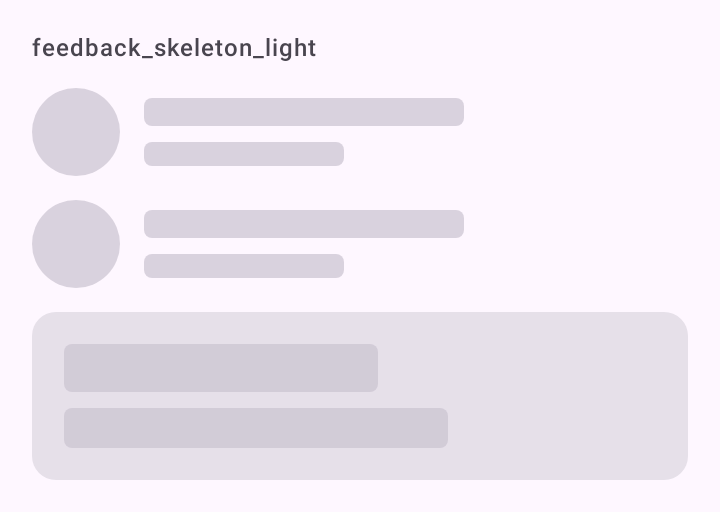

# DSSkeleton

Esqueleto de carregamento. `Modifier.dsSkeleton` troca um elemento por um bloco que pulsa devagar, na cor `outlineVariant`. `DSSkeletonRow` é uma linha pronta: um círculo e duas linhas. Não embrulha componente do Material; é desenho próprio sobre Compose.

## Quando usar

Quando a forma do conteúdo é conhecida. Monte a tela com valores de exemplo e aplique `dsSkeleton` em cada texto e imagem: o esqueleto fica com a forma final e nada pula quando o conteúdo chega.

`DSSkeletonRow` imita uma linha de lista com avatar (conversas, contatos).

Quando a forma não é conhecida, use [`DSLoadingState`](DSLoadingState.md).

## Uso

```kotlin
DSCard {
    Text(post.title, style = DSTheme.typography.titleMedium, modifier = Modifier.dsSkeleton(isLoading))

    Text(post.summary, style = DSTheme.typography.bodyMedium, modifier = Modifier.dsSkeleton(isLoading))
}
```

```kotlin
repeat(5) {
    DSSkeletonRow(Modifier.padding(DSSpacing.lg))
}
```

## Parâmetros

`Modifier.dsSkeleton`

| Parâmetro | Tipo | Padrão | Descrição |
| --- | --- | --- | --- |
| `isLoading` | `Boolean` | obrigatório | Enquanto `true`, o elemento vira o bloco. `false` não altera nada. |
| `shape` | `Shape` | `DSTheme.shapes.extraSmall` | Forma do bloco. Use `CircleShape` para avatares. |

`DSSkeletonRow`

| Parâmetro | Tipo | Padrão | Descrição |
| --- | --- | --- | --- |
| `modifier` | `Modifier` | `Modifier` | Modificador da linha (que já ocupa a largura toda). |

## Acessibilidade

- Enquanto carrega, o elemento não recebe toque e sai do TalkBack (`clearAndSetSemantics`). Anuncie o carregamento no contêiner da tela.
- `DSSkeletonRow` não é lido pelo TalkBack.
- Com "Remover animações" (`DSTheme.reduceMotion`), o bloco fica parado.

## Screenshots

`feedback_skeleton`:



Também existem `feedback_skeleton_dark` e `_font200`.
