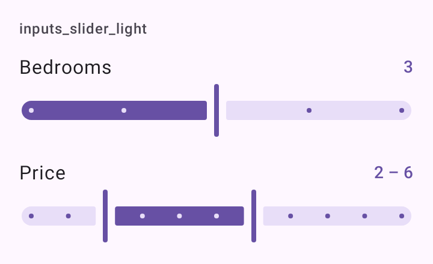

# DSSlider

Slider com rótulo e o valor atual escrito ao lado, porque o slider sozinho não diz o número. `DSSlider` embrulha `Slider` do Material 3; `DSRangeSlider` embrulha `RangeSlider`, com duas alças.

## Quando usar

- `DSSlider`: um valor num intervalo (quartos, raio de busca).
- `DSRangeSlider`: um intervalo entre dois valores (faixa de preço).

Para um número exato digitado, use [`DSNumberField`](DSNumberField.md).

## Uso

```kotlin
var rooms by remember { mutableFloatStateOf(3f) }

DSSlider(
    value = rooms,
    onValueChange = { rooms = it },
    label = "Quartos",
    valueRange = 1f..5f,
    steps = 3,
    valueText = "${rooms.roundToInt()} quartos"
)
```

```kotlin
var price by remember { mutableStateOf(2f..6f) }

DSRangeSlider(
    value = price,
    onValueChange = { price = it },
    label = "Preço",
    valueRange = 0f..10f,
    steps = 9,
    minimumDistance = 1f,
    valueText = "R$ ${price.start.roundToInt()} – ${price.endInclusive.roundToInt()} mil"
)
```

## Parâmetros

`DSSlider`

| Parâmetro | Tipo | Padrão | Descrição |
| --- | --- | --- | --- |
| `value` | `Float` | obrigatório | O valor atual. |
| `onValueChange` | `(Float) -> Unit` | obrigatório | Chamado durante o arraste. |
| `label` | `String` | obrigatório | Rótulo acima, à esquerda. Também é a descrição do slider no TalkBack. |
| `modifier` | `Modifier` | `Modifier` | Modificador da coluna (rótulo e slider). |
| `valueRange` | `ClosedFloatingPointRange<Float>` | `0f..1f` | O intervalo. |
| `steps` | `Int` | `0` | Quantos pontos intermediários entre as pontas; `0` é contínuo. |
| `valueText` | `String?` | `null` | O valor formatado ao lado do rótulo ("3 quartos", "R$ 500 mil"), na cor primária. |
| `enabled` | `Boolean` | `true` | Habilita ou desabilita o slider. |

`DSRangeSlider`

| Parâmetro | Tipo | Padrão | Descrição |
| --- | --- | --- | --- |
| `value` | `ClosedFloatingPointRange<Float>` | obrigatório | O intervalo atual. |
| `onValueChange` | `(ClosedFloatingPointRange<Float>) -> Unit` | obrigatório | Chamado durante o arraste. Mudanças que deixariam as alças mais perto que `minimumDistance` são descartadas. |
| `label` | `String` | obrigatório | Rótulo acima. Também é a descrição no TalkBack. |
| `modifier` | `Modifier` | `Modifier` | Modificador da coluna. |
| `valueRange` | `ClosedFloatingPointRange<Float>` | `0f..1f` | O intervalo possível. |
| `steps` | `Int` | `0` | Pontos intermediários entre as pontas; `0` é contínuo. |
| `minimumDistance` | `Float` | `0f` | A menor distância entre as alças, no valor. |
| `valueText` | `String?` | `null` | O intervalo formatado ao lado do rótulo. |
| `enabled` | `Boolean` | `true` | Habilita ou desabilita o slider. |

## Acessibilidade

- O `label` vira o `contentDescription` do slider; o TalkBack lê o rótulo e o valor do Material.
- `valueText` é só visual: não entra na semântica do slider.

## Screenshots

`inputs_slider`:



Também existem `inputs_slider_dark`, `_font200`, `_rtl` e `_highcontrast`.
