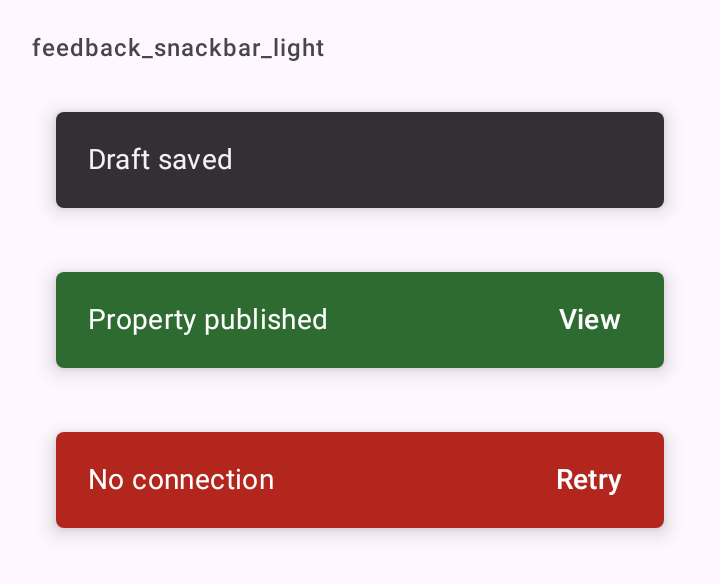

# DSSnackbar

Snackbar do DSKit: o `Snackbar` do Material 3 com um tom (`DSSnackbarStyle`). Você não chama o snackbar direto. Mostra com `SnackbarHostState.showDSSnackbar` e exibe num `DSSnackbarHost` (que embrulha `SnackbarHost`).

## Quando usar

Para confirmar algo que acabou de acontecer, ou um erro que não toma a tela.

| Estilo | Uso |
| --- | --- |
| `Default` | A superfície inversa do Material: avisos neutros ("Rascunho salvo"). Padrão. |
| `Success` | Cor de sucesso: uma ação que deu certo e merece destaque ("Imóvel publicado"). |
| `Error` | Cor de erro: algo falhou e não toma a tela ("Sem conexão"). |

O [`DSScreen`](DSScreen.md) já põe o host quando recebe um `snackbarHostState`; use `DSSnackbarHost` direto só num layout próprio. Para um aviso que fica até ser resolvido, use [`DSBanner`](DSBanner.md). Para a tela que não carregou, use [`DSErrorState`](DSErrorState.md).

## Uso

```kotlin
val snackbarHostState = remember { SnackbarHostState() }
val scope = rememberCoroutineScope()

DSScreen(title = "Publicações", snackbarHostState = snackbarHostState) { padding ->
    // conteúdo
}

scope.launch {
    val result = snackbarHostState.showDSSnackbar("Sem conexão", DSSnackbarStyle.Error, actionLabel = "Tentar")

    if (result == SnackbarResult.ActionPerformed) retry()
}
```

## Parâmetros

`SnackbarHostState.showDSSnackbar` (suspensa; espera o snackbar sumir e devolve `SnackbarResult`, que diz se o usuário tocou na ação)

| Parâmetro | Tipo | Padrão | Descrição |
| --- | --- | --- | --- |
| `message` | `String` | obrigatório | O texto. |
| `style` | `DSSnackbarStyle` | `DSSnackbarStyle.Default` | `Default`, `Success` ou `Error`. |
| `actionLabel` | `String?` | `null` | Rótulo da ação. Com ação, o snackbar fica até ser tocado ou dispensado (`SnackbarDuration.Indefinite`); sem ação, dura `Short`. |
| `withDismissAction` | `Boolean` | `false` | Mostra o "x" de dispensar. |

`DSSnackbarHost`

| Parâmetro | Tipo | Padrão | Descrição |
| --- | --- | --- | --- |
| `hostState` | `SnackbarHostState` | obrigatório | O estado onde os snackbars são mostrados. |
| `modifier` | `Modifier` | `Modifier` | Modificador do host. |

`DSSnackbarVisuals` (o `SnackbarVisuals` do Material com o tom; use para chamar `showSnackbar` direto)

| Parâmetro | Tipo | Padrão | Descrição |
| --- | --- | --- | --- |
| `message` | `String` | obrigatório | O texto. |
| `style` | `DSSnackbarStyle` | `DSSnackbarStyle.Default` | O tom. |
| `actionLabel` | `String?` | `null` | Rótulo da ação. |
| `withDismissAction` | `Boolean` | `false` | Mostra o "x" de dispensar. |
| `duration` | `SnackbarDuration` | `Short` sem ação, `Indefinite` com ação | Quanto tempo fica. |

Um snackbar mostrado com `showSnackbar` comum (sem `DSSnackbarVisuals`) sai no estilo `Default`.

## Acessibilidade

- O `SnackbarHost` do Material 3 anuncia cada snackbar ao TalkBack como região ao vivo (`liveRegion`).

## Screenshots

`feedback_snackbar`:



Também existem `feedback_snackbar_dark`, `_font200`, `_rtl` e `_highcontrast`.
