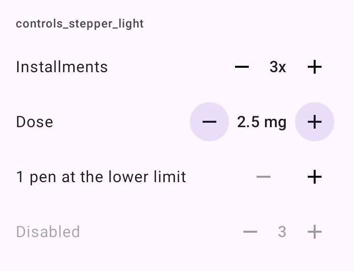

# DSStepper

Ajuste de um número em passos: o rótulo e os botões − e +. O Material 3 não tem esta peça; o DSKit a monta com os botões de ícone do Material (`IconButton`, `FilledTonalIconButton`…).

## Quando usar

Para o ajuste fino de um valor que já tem um ponto de partida: dose, peso, parcelas, quantidade, dias de antecedência.

- Para digitar o número, use o [`DSDecimalField`](DSNumberField.md) ou o [`DSNumberField`](DSNumberField.md). Os dois se combinam: o campo para digitar e o stepper embaixo para o ajuste fino (com `valueText = null`).
- Para escolher numa faixa arrastando, use o [`DSSlider`](DSSlider.md).

## Uso

```kotlin
var installments by rememberSaveable { mutableIntStateOf(1) }

DSStepper(
    value = installments,
    onValueChange = { installments = it },
    range = 1..12,
    label = "Parcelas",
    valueText = "${installments}x"
)
```

Com casas decimais:

```kotlin
DSStepper(
    value = dose,
    onValueChange = { dose = it },
    range = 0.0..40.0,
    step = 0.25,
    label = "Ajuste fino",
    valueText = formatDose(dose),
    style = DSIconButtonStyle.Tonal
)
```

## Parâmetros

| Parâmetro | Tipo | Padrão | Descrição |
| --- | --- | --- | --- |
| `value` | `Double` ou `Int` | obrigatório | O valor atual. |
| `onValueChange` | `(Double) -> Unit` ou `(Int) -> Unit` | obrigatório | Chamado a cada passo, com o valor já dentro da faixa. |
| `range` | `ClosedFloatingPointRange<Double>` ou `IntRange` | obrigatório | Os limites. No limite, o botão daquele lado desliga. |
| `step` | `Double` (obrigatório) ou `Int` (`1`) | | Quanto cada toque soma. |
| `label` | `String` | obrigatório | O que está sendo ajustado. Também nomeia os botões para o TalkBack. |
| `modifier` | `Modifier` | `Modifier` | Modificador da linha, que ocupa a largura toda. |
| `valueText` | `String?` | `null` (`Double`), o número (`Int`) | O valor como deve ser lido e mostrado entre os botões ("2,5 mg", "3x"). `null` não mostra nada ali. |
| `style` | `DSIconButtonStyle` | `Standard` | O estilo dos dois botões. |
| `enabled` | `Boolean` | `true` | Desabilitado, a linha esmaece e os botões não respondem. |
| `decreaseDescription` | `String` | "Diminuir {label}" | O que o TalkBack lê no −. |
| `increaseDescription` | `String` | "Aumentar {label}" | O que o TalkBack lê no +. |

## Comportamento

- Cada passo vibra de leve.
- Segurar um botão por 350 ms começa a repetir o passo, de 150 ms em 150 ms e acelerando até 40 ms. Soltar não soma mais um.
- A soma é arredondada na quarta casa: 0,1 + 0,2 dá 0,3.
- Os botões não são o [`DSIconButton`](DSIconButton.md) porque o toque longo dele abre a dica, e aqui o toque longo é repetir.

## Acessibilidade

- Os botões têm o alvo de 48 dp do Material e são lidos "Diminuir {label}" e "Aumentar {label}" (strings da lib, nas 10 línguas), com o `valueText` como estado.
- No limite, o TalkBack anuncia o botão como desabilitado.

## Screenshots

`controls_stepper`:



Também existem `controls_stepper_dark`, `_font200`, `_rtl` e `_highcontrast`.
