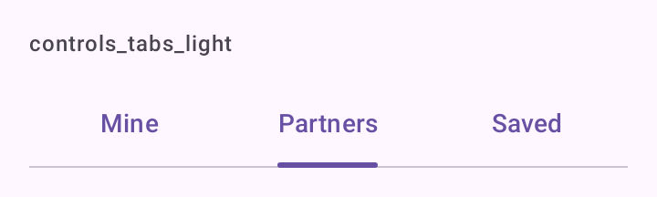

# DSTabs

Abas primárias do Material 3, no topo do conteúdo. `DSTabs` embrulha `PrimaryTabRow` com `Tab`. `DSTabbedPager` junta as abas a um `HorizontalPager`.

## Quando usar

- `DSTabs`: de duas a cinco seções irmãs da mesma tela ("Minhas", "Parceiros"). Você controla a aba marcada.
- `DSTabbedPager`: para trocar de seção deslizando para o lado ou tocando na aba; as duas coisas ficam sincronizadas.

Para trocar entre destinos principais do app, use [`DSNavigationBar`](DSNavigationBar.md).

## Uso

```kotlin
var tab by remember { mutableIntStateOf(0) }

DSTabs(tabs = listOf("Minhas", "Parceiros", "Salvas"), selectedIndex = tab, onSelect = { tab = it })
```

```kotlin
DSTabbedPager(tabs = listOf("Fotos", "Detalhes")) { index ->
    when (index) {
        0 -> Photos()

        else -> Details()
    }
}
```

## Parâmetros

`DSTabs`

| Parâmetro | Tipo | Padrão | Descrição |
| --- | --- | --- | --- |
| `tabs` | `List<String>` | obrigatório | Títulos das abas. Cortados com reticências em uma linha. |
| `selectedIndex` | `Int` | obrigatório | Índice da aba marcada. |
| `onSelect` | `(Int) -> Unit` | obrigatório | Chamado com o índice tocado. |
| `modifier` | `Modifier` | `Modifier` | Modificador da linha de abas. |

`DSTabbedPager`

| Parâmetro | Tipo | Padrão | Descrição |
| --- | --- | --- | --- |
| `tabs` | `List<String>` | obrigatório | Títulos das abas; definem o número de páginas. |
| `modifier` | `Modifier` | `Modifier` | Modificador da coluna (abas e páginas). |
| `page` | `@Composable (index: Int) -> Unit` | obrigatório | Conteúdo de cada página. |

O `DSTabbedPager` guarda o estado da página por dentro; não há como ler ou mudar a página de fora.

## Acessibilidade

- `Tab` do Material 3 expõe `Role.Tab` e o estado marcado ao TalkBack.
- Tocar a aba já marcada não vibra.

## Screenshots

`controls_tabs`:



Também existem `controls_tabs_dark`, `_font200`, `_rtl` e `_highcontrast`.
