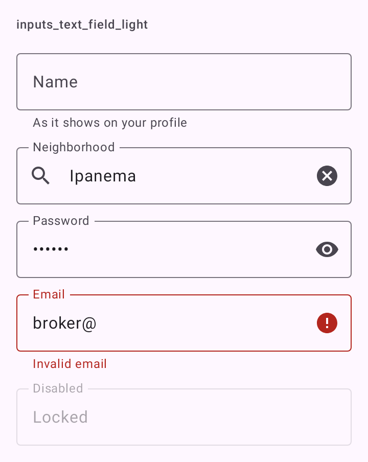

# DSTextField

Campo de texto do Material 3 (`OutlinedTextField`), com contorno e rótulo que flutua para a borda ao focar. Abaixo dele vai o texto de apoio ou, se houver, o erro. Ocupa a largura toda.

## Quando usar

Para entrada de texto livre: nome, e-mail, senha, busca, descrição. Para números inteiros, use [`DSNumberField`](DSNumberField.md). Para escolher entre opções fixas, use [`DSDropdownField`](DSDropdownField.md). Para sugestões enquanto digita, use [`DSAutocompleteField`](DSAutocompleteField.md).

Só um ícone aparece à direita, nesta ordem de prioridade: olho da senha (`password`), botão de limpar (`clearable`, com texto, habilitado e editável), ícone de erro.

## Uso

```kotlin
DSTextField(
    value = email,
    onValueChange = { email = it },
    label = "E-mail",
    errorText = if (emailInvalid) "E-mail inválido" else null,
    keyboardOptions = KeyboardOptions(keyboardType = KeyboardType.Email, imeAction = ImeAction.Next)
)

DSTextField(value = password, onValueChange = { password = it }, label = "Senha", password = true)
```

```kotlin
DSTextField(
    value = description,
    onValueChange = { description = it },
    label = "Descrição",
    supportingText = "Mínimo 20 caracteres",
    singleLine = false,
    maxLines = 6
)
```

## Parâmetros

| Parâmetro | Tipo | Padrão | Descrição |
| --- | --- | --- | --- |
| `value` | `String` | obrigatório | O texto atual. |
| `onValueChange` | `(String) -> Unit` | obrigatório | Chamado a cada edição. |
| `label` | `String` | obrigatório | Rótulo do campo; é também o que o TalkBack lê. |
| `modifier` | `Modifier` | `Modifier` | Modificador do campo (que já ocupa a largura toda). |
| `placeholder` | `String?` | `null` | Dica dentro do campo vazio, depois que o rótulo flutuou. |
| `supportingText` | `String?` | `null` | Linha de apoio ("Mínimo 6 caracteres"). Some quando há erro. |
| `errorText` | `String?` | `null` | Mensagem de erro. Não nula, o campo fica em estado de erro. |
| `leadingIcon` | `ImageVector?` | `null` | Ícone decorativo no início (busca, e-mail). |
| `password` | `Boolean` | `false` | Esconde o texto e mostra o olho para alternar. Com `keyboardOptions` padrão, usa `KeyboardType.Password`. |
| `clearable` | `Boolean` | `false` | Mostra o botão de limpar enquanto há texto. |
| `enabled` | `Boolean` | `true` | Habilita ou desabilita o campo. |
| `readOnly` | `Boolean` | `false` | Mostra o valor sem deixar editar. |
| `singleLine` | `Boolean` | `true` | `false` para textos longos, que crescem até `maxLines`. |
| `maxLines` | `Int` | `1` se `singleLine`, senão `Int.MAX_VALUE` | Máximo de linhas. |
| `keyboardOptions` | `KeyboardOptions` | `KeyboardOptions.Default` | Tipo de teclado e ação do IME. |
| `keyboardActions` | `KeyboardActions` | `KeyboardActions.Default` | O que fazer na ação do IME. |

## Acessibilidade

- O TalkBack lê o `label`.
- Com `errorText`, o campo ganha a semântica `error(errorText)` e o TalkBack anuncia o erro.
- O olho da senha tem a descrição "Mostrar senha" / "Ocultar senha"; o botão de limpar, "Limpar". Os dois são `IconButton` com alvo de 48 dp.
- `leadingIcon` e o ícone de erro são decorativos.

## Screenshots

`inputs_text_field`:



Também existem `inputs_text_field_dark`, `_font200`, `_rtl` e `_highcontrast`.
