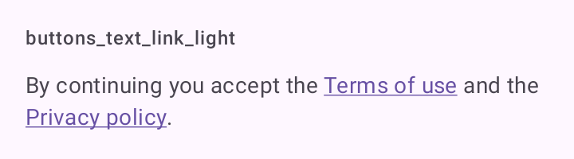

# DSTextLink

Texto corrido com links no meio: "Ao continuar, você aceita os Termos e a Política de privacidade". Usa `Text` do Material 3 com `LinkAnnotation` do Compose.

## Quando usar

Quando o link faz parte de uma frase. Cada item de `links` marca a primeira ocorrência do seu trecho em `text`, sublinhada na cor primária.

Link sozinho, fora de uma frase, é um [`DSTextButton`](DSButton.md).

Os links são do tipo `DSLink`:

- `DSLink.Url(text, url)`: abre `url` no navegador (ou no app que a trata), via `LocalUriHandler`.
- `DSLink.Action(text, onClick)`: chama `onClick`, para abrir uma tela do app.

## Uso

```kotlin
DSTextLink(
    text = "Ao continuar, você aceita os Termos de uso e a Política de privacidade.",
    links = listOf(
        DSLink.Url("Termos de uso", "https://example.com/terms"),
        DSLink.Action("Política de privacidade") { openPrivacy() }
    )
)
```

## Parâmetros

| Parâmetro | Tipo | Padrão | Descrição |
| --- | --- | --- | --- |
| `text` | `String` | obrigatório | O texto completo. |
| `links` | `List<DSLink>` | obrigatório | Trechos que viram link. Trecho não encontrado é ignorado; trecho que se sobrepõe a um anterior também. |
| `modifier` | `Modifier` | `Modifier` | Modificador do texto. |
| `style` | `TextStyle` | `DSTheme.typography.bodyMedium` | Estilo do texto. |
| `color` | `Color` | `DSTheme.colors.onSurfaceVariant` | Cor do texto fora dos links. |

## Acessibilidade

- O TalkBack lista os links no menu de ações, e cada link ganha foco próprio.
- Link pressionado ganha fundo `primaryContainer`.
- Toque num link vibra leve, respeitando `DSTheme.hapticsEnabled`.

## Screenshots

`buttons_text_link`:



Também existem `buttons_text_link_dark`, `_font200`, `_rtl` e `_highcontrast`.
