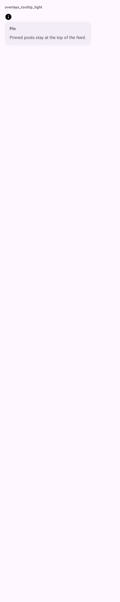

# DSTooltip

Dica do Material 3 (`TooltipBox`) que aparece ao tocar e segurar (ou passar o mouse) no `content`. Sem `title`, é a `PlainTooltip`; com `title`, é a `RichTooltip`.

## Quando usar

- Dica simples (sem `title`): uma linha curta que some sozinha, para dizer o que um ícone faz.
- Dica rica (com `title`): fica até o usuário tocar fora, para explicar um recurso em duas ou três linhas. Vai num ícone de informação ou num elemento sem dica própria.

Não envolva um [`DSIconButton`](DSIconButton.md): ele já mostra a dica simples com o `contentDescription`.

Não esconda informação necessária numa dica: quem não sabe que pode segurar nunca a vê.

## Uso

```kotlin
DSTooltip(text = "Publicações fixadas ficam no topo do feed.", title = "Fixar") {
    Icon(DSIcons.Info, contentDescription = "Sobre fixar")
}
```

## Parâmetros

| Parâmetro | Tipo | Padrão | Descrição |
| --- | --- | --- | --- |
| `text` | `String` | obrigatório | O texto da dica. |
| `modifier` | `Modifier` | `Modifier` | Modificador da `TooltipBox`. |
| `title` | `String?` | `null` | Com título, a dica é rica e persistente. |
| `content` | `@Composable () -> Unit` | obrigatório | O elemento que mostra a dica ao ser segurado. |

## Acessibilidade

- O `content` precisa do próprio rótulo (`contentDescription`); a dica não substitui o rótulo.

## Screenshots

`overlays_tooltip` (dica rica aberta):



Só existe a versão clara.
