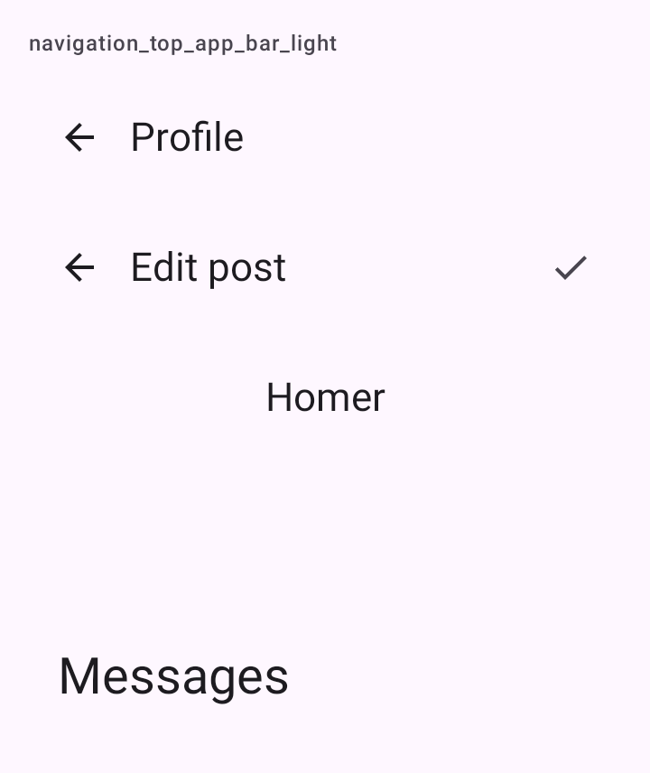

# DSTopAppBar

Barra superior do Material 3: seta de voltar, título e ações à direita. Embrulha `TopAppBar`, `CenterAlignedTopAppBar`, `MediumTopAppBar` ou `LargeTopAppBar`, conforme o estilo.

## Quando usar

Normalmente quem desenha a barra é o [`DSScreen`](DSScreen.md), que também a faz encolher ao rolar. Use `DSTopAppBar` direto só num layout próprio; aí ela não encolhe.

| Estilo (`DSTopAppBarStyle`) | Uso |
| --- | --- |
| `Small` | Título pequeno alinhado ao início: o padrão das telas de detalhe e formulário. |
| `CenterAligned` | Título centralizado: a tela principal de uma aba, com o nome ou a marca do app. |
| `Medium` | Título médio que encolhe para a barra pequena ao rolar. |
| `Large` | Título grande que encolhe para a barra pequena ao rolar: telas de topo com pouco conteúdo acima da lista. |

Em `actions`, ponha até três [`DSIconButton`](DSIconButton.md)s; o resto vai num menu de "mais".

## Uso

```kotlin
DSTopAppBar("Editar publicação", onBack = { navController.popBackStack() }) {
    DSIconButton(DSIcons.Check, "Salvar", onClick = { save() })
}
```

```kotlin
DSTopAppBar("Homer", style = DSTopAppBarStyle.CenterAligned)
```

## Parâmetros

| Parâmetro | Tipo | Padrão | Descrição |
| --- | --- | --- | --- |
| `title` | `String` | obrigatório | O título, em uma linha, cortado com reticências. |
| `modifier` | `Modifier` | `Modifier` | Modificador da barra. |
| `style` | `DSTopAppBarStyle` | `DSTopAppBarStyle.Small` | `Small`, `CenterAligned`, `Medium` ou `Large`. |
| `onBack` | `(() -> Unit)?` | `null` | Mostra a seta de voltar (espelhada em árabe); quem chama faz o pop. O voltar do sistema continua sendo do app (`BackHandler` ou a biblioteca de navegação). |
| `actions` | `@Composable RowScope.() -> Unit` | `{}` | Ações à direita. |

## Acessibilidade

- O título é marcado como `heading()`, para o TalkBack navegar por títulos.
- A seta de voltar tem a descrição "Voltar" (`dskit_back`) e alvo de 48 dp (`IconButton` do Material 3).

## Screenshots

`navigation_top_app_bar`:



Também existem `navigation_top_app_bar_dark`, `_font200`, `_rtl` e `_highcontrast`.
