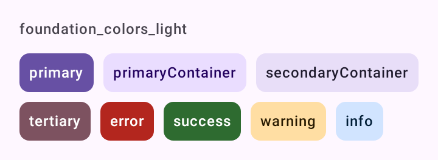
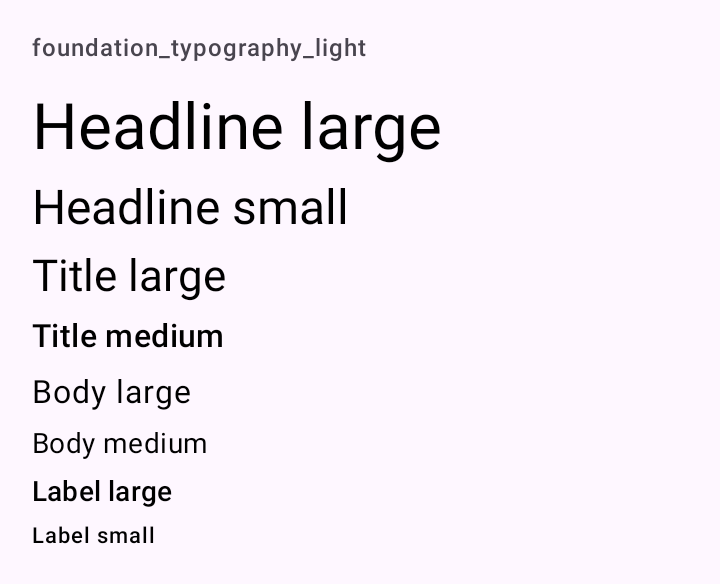

# Theme

A base do DSKit, no módulo `tokens`: o tema (`DSTheme`), a marca (`DSBrand`, `DSContrast`), as cores de status (`DSStatusColors`), a tipografia (`DSTypography`), o espaçamento (`DSSpacing`, `DSTouchTarget`) e o movimento (`DSMotion`). `DSTheme` é um `MaterialTheme` do Material 3 com as cores da marca, a fonte do app e as formas do Material.

## Quando usar

Envolva o app inteiro num `DSTheme`. Tudo dentro dele, inclusive componentes do Material que o DSKit não embrulha (`DatePicker`, `DropdownMenu`), já sai com a cara do app.

Leia o tema atual pelo objeto `DSTheme`, num lugar só:

| Membro | Tipo | Origem |
| --- | --- | --- |
| `DSTheme.colors` | `ColorScheme` | `MaterialTheme.colorScheme` |
| `DSTheme.typography` | `Typography` | `MaterialTheme.typography` |
| `DSTheme.shapes` | `Shapes` | `MaterialTheme.shapes` |
| `DSTheme.status` | `DSStatusColors` | `LocalDSStatusColors` |
| `DSTheme.reduceMotion` | `Boolean` | `LocalDSReduceMotion`: `true` com "Remover animações" ligado (escala de animação 0) |
| `DSTheme.hapticsEnabled` | `Boolean` | `LocalDSHapticsEnabled`: a vibração dos componentes na subárvore |

## Uso

De uma cor só, com o módulo opcional `seed`:

```kotlin
val HomerBrand = remember { DSBrand.fromSeed(Color(0xFF3C0079)) } // ou style = DSSeedStyle.Fidelity

DSTheme(brand = HomerBrand) {
    App()
}
```

Ou com os esquemas exportados do Material Theme Builder:

```kotlin
val HomerBrand = DSBrand(
    light = lightScheme,
    dark = darkScheme,
    lightMediumContrast = mediumContrastLightColorScheme,
    darkMediumContrast = mediumContrastDarkColorScheme,
    lightHighContrast = highContrastLightColorScheme,
    darkHighContrast = highContrastDarkColorScheme
)

DSTheme(brand = HomerBrand, fontFamily = Raleway) {
    App()
}
```

```kotlin
Text(
    "Imóvel publicado",
    style = DSTheme.typography.titleMedium,
    color = DSTheme.status.success.onContainer,
    modifier = Modifier
        .background(DSTheme.status.success.container, DSTheme.shapes.small)
        .padding(horizontal = DSSpacing.md, vertical = DSSpacing.sm)
)
```

## Parâmetros

### `DSTheme`

| Parâmetro | Tipo | Padrão | Descrição |
| --- | --- | --- | --- |
| `brand` | `DSBrand` | `DSBrand.Default` | A marca: esquemas de cor e cores de status. |
| `darkTheme` | `Boolean` | `isSystemInDarkTheme()` | Usa o esquema escuro. |
| `dynamicColor` | `Boolean` | `false` | Usa as cores do papel de parede (Material You) no Android 12+; abaixo disso, a marca. As cores de status continuam as da marca. As cores dinâmicas já seguem o contraste do sistema. |
| `contrast` | `DSContrast` | `rememberSystemContrast()` | O nível de contraste. O padrão segue o "Contraste de cor" do Android 14+ e escolhe o esquema correspondente do `brand`. |
| `fontFamily` | `FontFamily?` | `null` | A fonte do app, em toda a escala de tipo. `null` mantém a do sistema. |
| `shapes` | `Shapes` | `Shapes()` | As formas do Material (`extraSmall`…`extraLarge`); o padrão é o do Material 3. |
| `hapticsEnabled` | `Boolean` | `true` | Liga e desliga a vibração dos componentes (o "Vibração" do app). |
| `content` | `@Composable () -> Unit` | obrigatório | O app. |

### `DSBrand`

A marca do app: os esquemas de cor do Material 3, claro e escuro, e as cores de status.

Gere os esquemas no [Material Theme Builder](https://material-foundation.github.io/material-theme-builder/) a partir da cor da marca e exporte para Jetpack Compose. O arquivo exportado traz o `lightScheme` e o `darkScheme` prontos, com todos os papéis calculados em tons que passam no contraste. As cores de status entram como "custom colors" do mesmo builder.

O mesmo arquivo traz os esquemas de contraste médio e alto (`mediumContrastLightColorScheme`…). Passe-os para o `DSTheme` seguir o "Contraste de cor" do Android 14+. Sem eles, vale o esquema padrão.

| Parâmetro | Tipo | Padrão | Descrição |
| --- | --- | --- | --- |
| `light` | `ColorScheme` | obrigatório | Esquema claro, contraste padrão. |
| `dark` | `ColorScheme` | obrigatório | Esquema escuro, contraste padrão. |
| `lightStatus` | `DSStatusColors` | `DSStatusColors.Light` | Cores de status no claro. |
| `darkStatus` | `DSStatusColors` | `DSStatusColors.Dark` | Cores de status no escuro. |
| `lightMediumContrast` | `ColorScheme?` | `null` | Esquema claro de contraste médio. |
| `darkMediumContrast` | `ColorScheme?` | `null` | Esquema escuro de contraste médio. |
| `lightHighContrast` | `ColorScheme?` | `null` | Esquema claro de contraste alto. |
| `darkHighContrast` | `ColorScheme?` | `null` | Esquema escuro de contraste alto. |

- `colorScheme(darkTheme, contrast)` devolve o esquema pedido. Sem o de alto, cai no médio; sem o médio, no padrão.
- `DSBrand.Default` é o esquema base do Material 3 (`lightColorScheme()`/`darkColorScheme()`), para previews e para começar antes da marca existir.

### `DSContrast` e `rememberSystemContrast`

`DSContrast` é o nível de contraste de cor do Material 3 (Configurações > Acessibilidade > Contraste): `Standard`, `Medium` e `High`.

`rememberSystemContrast()` lê o "Contraste de cor" do sistema no Android 14+ e se atualiza quando o usuário muda a opção. O sistema dá um valor de -1 a 1: a partir de 0,5 é `Medium`, a partir de 1 é `High`. Antes do Android 14, devolve `Standard`.

### `DSStatusColors`

Cores de status que o Material não tem (ele só tem `error`): `success`, `warning` e `info`. Cada uma é um `DSColorRole(color, onColor, container, onContainer)`, o mesmo formato das "custom colors" do Material Theme Builder.

Use o contêiner para fundos e a cor cheia para ícones e textos curtos.

| Conjunto | Tons | Uso |
| --- | --- | --- |
| `DSStatusColors.Light` | 40/100/90/10 de verde, âmbar e azul | Tema claro, como o Theme Builder gera. |
| `DSStatusColors.Dark` | 80/20/30/90 | Os mesmos papéis no tema escuro. |

As cores de status não mudam com o contraste nem com `dynamicColor`.

### `DSTypography`

A escala de tipo do Material 3 (display, headline, title, body, label) com a família de fonte do app. Tamanhos, pesos e entrelinhas são os do Material; só a família muda. Em `sp`, então escala com a fonte do sistema.

| Membro | Descrição |
| --- | --- |
| `create(fontFamily: FontFamily? = null): Typography` | A escala do Material com `fontFamily` em todos os estilos; `null` mantém a fonte do sistema (Roboto). O `DSTheme` já chama. |

### `DSSpacing` e `DSTouchTarget`

Escala de espaçamento na grade de 4 dp do Material.

| Token | Valor |
| --- | --- |
| `DSSpacing.xxs` | `2.dp` |
| `DSSpacing.xs` | `4.dp` |
| `DSSpacing.sm` | `8.dp` |
| `DSSpacing.md` | `12.dp` |
| `DSSpacing.lg` | `16.dp` |
| `DSSpacing.xl` | `24.dp` |
| `DSSpacing.xxl` | `32.dp` |
| `DSTouchTarget.minimum` | `48.dp`, o alvo mínimo de toque do Android |

### `DSMotion`

Durações e curvas da especificação de movimento do Material 3, para as animações que o componente monta sozinho (os componentes do Material já trazem as deles). As animações do Compose respeitam "Remover animações" do sistema.

| Membro | Valor | Uso |
| --- | --- | --- |
| `standard` | `CubicBezierEasing(0.2f, 0f, 0f, 1f)` | Curva padrão: entra e sai suave, para mudanças dentro da tela. |
| `emphasizedDecelerate` | `CubicBezierEasing(0.05f, 0.7f, 0.1f, 1f)` | Entrada enfática: chega rápido e assenta devagar. |
| `emphasizedAccelerate` | `CubicBezierEasing(0.3f, 0f, 0.8f, 0.15f)` | Saída enfática: sai acelerando. |
| `short<T>()` | `tween(150, standard)` | Troca de cor, de estado, de ícone. |
| `medium<T>()` | `tween(300, standard)` | Elemento que aparece, some ou muda de tamanho. |
| `long<T>()` | `tween(500, emphasizedDecelerate)` | Transição que atravessa a tela. |

```kotlin
AnimatedVisibility(visible, enter = fadeIn(DSMotion.short()), exit = fadeOut(DSMotion.short())) {
    Content()
}
```

Para animação infinita (um pulso), confira `DSTheme.reduceMotion` e deixe parado quando for `true`.

## Acessibilidade

- O contraste segue o "Contraste de cor" do Android 14+ quando a marca traz os esquemas de contraste médio e alto.
- A tipografia é em `sp` e escala com o tamanho de fonte do sistema.
- `DSTheme.reduceMotion` reflete "Remover animações"; `DSTheme.hapticsEnabled` desliga a vibração de todos os componentes.
- `DSTouchTarget.minimum` é o alvo de 48 dp usado pelos componentes que não vêm do Material.

## Screenshots

`foundation_colors`:



Também existem `foundation_colors_dark`, `_font200`, `_rtl` e `_highcontrast`.

`foundation_typography`:



Também existem `foundation_typography_dark`, `_font200`, `_rtl` e `_highcontrast`.
